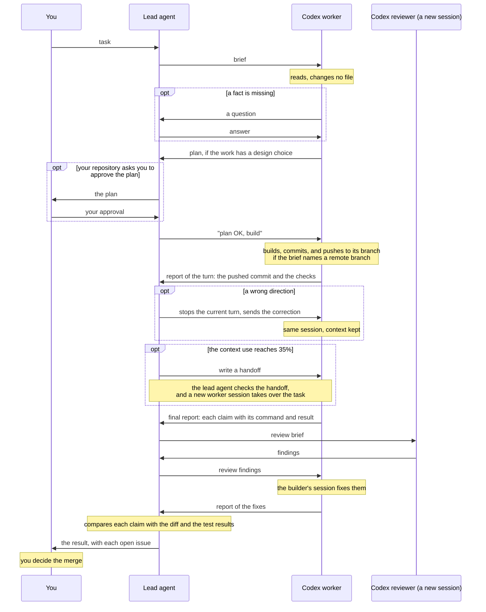

# Codex workers: guide for people

This file is for a person who wants to see how the skill works. An agent reads `SKILL.md`, which
holds the rules and the commands. This file adds no rule.

## What the skill does

You talk with one agent: the lead agent. It is the Claude Code conversation that you start.
The lead agent gives build work and review work to Codex workers, and it talks with them when that
is needed. You approve, you decide, and you merge.

The lead agent's OK on a plan is not your approval. When the rules of your repository ask for your
approval, the lead agent stops and asks you.

## Who talks with whom

A worker and a reviewer send no messages to each other or to you. Each message passes through the
lead agent. The lead agent can ask the advisor at any step, before it decides.

## One task, turn by turn

The box "your repository asks you to approve the plan" is one example of an approval point. Your repository can ask for your approval at
other points too, and the lead agent stops and asks you at each of them.

The review is a new session that did not build the code. Its findings go to the lead agent, and the
lead agent sends them to the builder's session. After a handoff, that is the new session.

## Where the worker works

- The lead agent starts each worker in its own Git worktree and branch, which the brief names.
- A checkpoint is a step of the worker's plan after which it commits its work.
- If the brief names a remote branch, the worker pushes its commits to that branch at each
  checkpoint. It pushes to no other branch, and it does not force a push.
- A reviewer makes no commits.
- The lead agent can run more than one worker. It tells them the order of the commands that only
  one agent can run at a time, such as a heavy build.

## The 35% limit

The lead agent watches how full the context window of each Codex session is. When 35% of the
model's window is used, the worker writes a handoff. The lead agent checks and corrects it, and a
new worker continues from it.

The limit applies to a reviewer too. The lead agent splits a large review into parts before it
starts, so that each part ends under 35%.

35% is your limit. To change it, tell the lead agent, or change the number in `SKILL.md`.

## How to start it

Before you start:

1. Install the Codex CLI (`codex`) and sign in.
2. Put this folder where Claude Code finds skills, for example `.claude/skills/codex-workers/`.

Each start comes from you. The lead agent does not start this skill on its own. Start it in one of
these ways:

- Type `/codex-workers` in a conversation.
- Name the skill `codex-workers` in your message.
- Start another skill that tells the lead agent to read `SKILL.md`. Read that skill to see if it
  does this.
