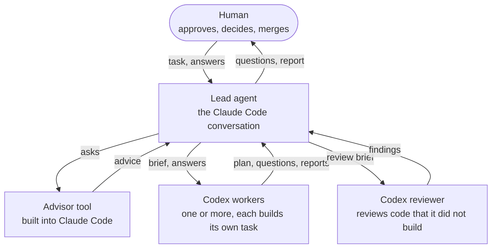
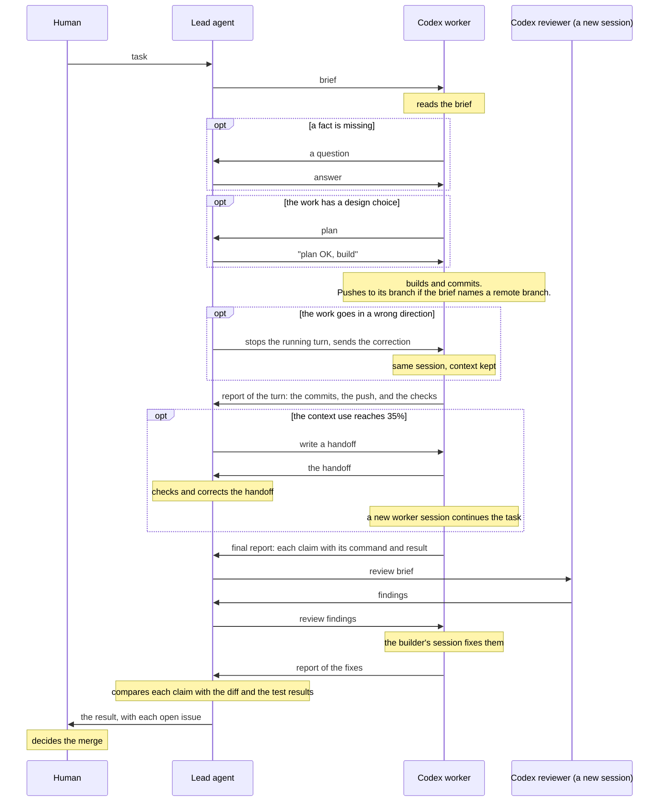

# Codex workers: guide for people

This file is for a person who wants to see how the skill works. An agent reads `SKILL.md`, which
holds the rules and the commands. This file adds no rule.

## What the skill does

The skill keeps a human in the loop.

The human talks with one agent: the lead agent. It is the Claude Code conversation that the human
starts. The lead agent gives build work and review work to Codex workers, and it talks with them
when that is needed. The human approves, decides, and merges.

The lead agent's OK on a plan is not the human's approval. When the rules of the repository ask for
the human's approval, the lead agent stops and asks the human.

## Who talks with whom

A worker and a reviewer send no messages to each other or to the human. Each message passes through
the lead agent. The lead agent can ask the advisor before it decides.

## One task, turn by turn

The diagram does not show the points where the human approves, because each repository has its own
rules. At each of these points, the lead agent stops and asks the human.

The review is a new session that did not build the code. Its findings go to the lead agent, and the
lead agent sends them to the builder's session. After a handoff, that is the new session.

## Where the worker works

- The lead agent starts each worker in its own Git worktree and branch, which the brief names.
- A checkpoint is a point that the worker's plan names.
- A turn is one run of the worker: from a message of the lead agent to the report of the worker.
- If the brief names a remote branch, the worker pushes its commits to that branch at each
  checkpoint. It pushes to no other branch, and it does not force a push.
- A reviewer makes no commits.
- The lead agent can run more than one worker at the same time, each on its own task, in its own
  worktree and branch. The turn diagram shows one of them. The lead agent tells them the order of
  the commands that only one agent can run at a time, such as a heavy build.

## The 35% limit

The context window is the text that a model can hold at one time: the brief, the messages, and the
files that it read. The lead agent watches how full the context window of each Codex session is.
When 35% of the model's window is used, the worker writes a handoff. The lead agent checks and
corrects it, and a new worker continues from it.

The limit applies to a reviewer too. The lead agent splits a large review into parts before it
starts, so that each part ends under 35%.

35% is the human's limit, and the human can change it.

## How to start it

Before the first start, the human does these steps:

1. Install the Codex CLI (`codex`) and sign in.
2. Put the folder of this file, with its `SKILL.md`, where Claude Code finds skills.

Each start comes from the human. The lead agent does not start this skill on its own. The human
starts it in one of these ways:

- Type `/codex-workers` in a conversation.
- Name the skill `codex-workers` in a message.
- Start another skill that tells the lead agent to read the `SKILL.md` of this skill. Read that
  skill to see if it does this.

`SKILL.md` has the commands, the models, and the full rules. The human can read it too.
