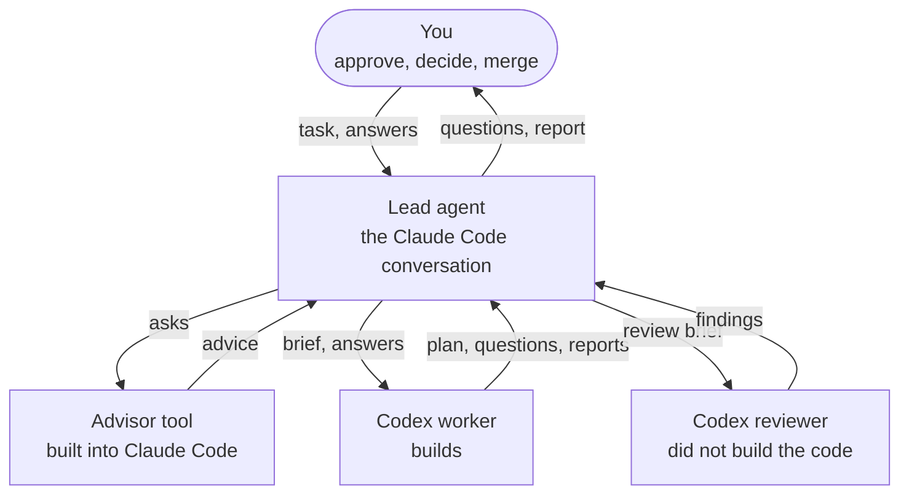
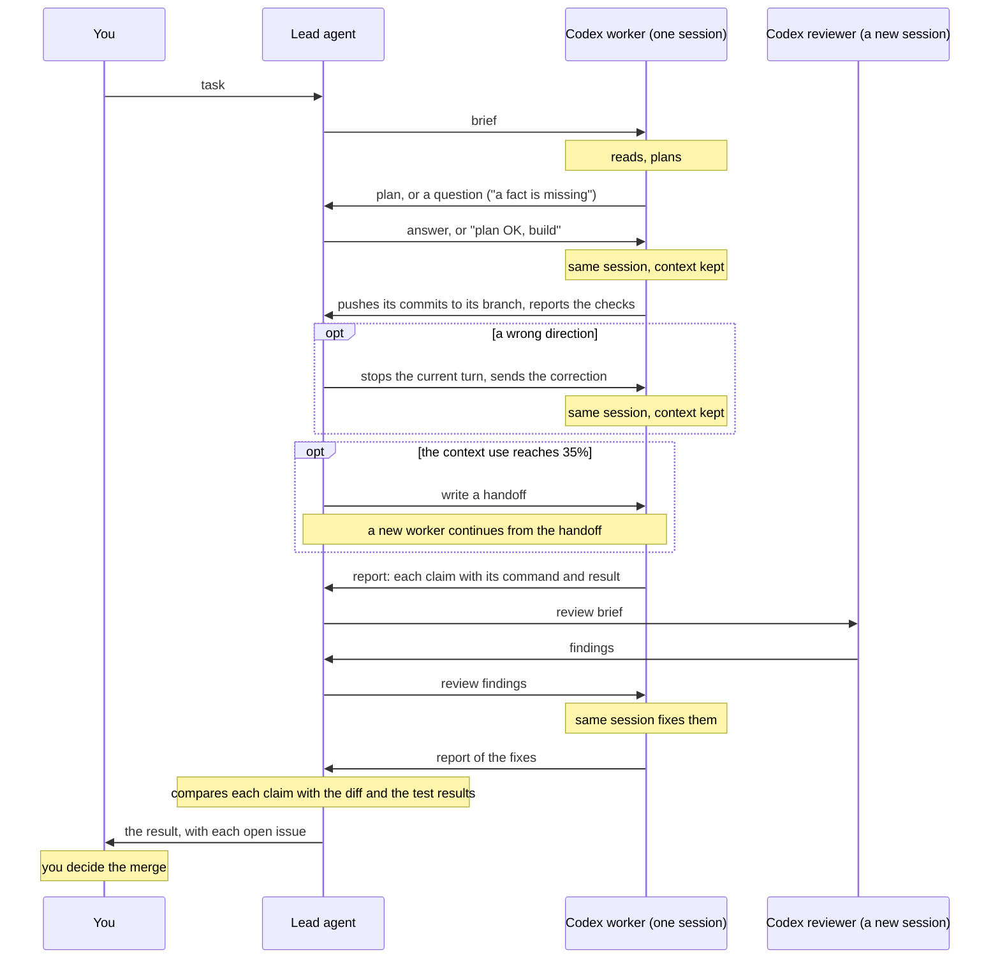

# Codex workers: guide for people

This file is for a person who wants to see how the skill works. An agent reads `SKILL.md`, which
holds the rules and the commands. This file adds no rule.

## What the skill does

You talk with one agent: the lead agent. It is the Claude Code conversation that you start.
The lead agent gives build work and review work to Codex workers, and it talks with them when that
is needed. You approve, you decide, and you merge.

The lead agent's OK on a plan is not your approval. When the rules of your repository ask for your
approval, the lead agent stops and asks you.

## Who talks with whom

A worker and a reviewer send no messages to each other or to you. Each message passes through the
lead agent.

## One task, turn by turn

The diagram does not show the points where you approve, because each repository has its own rules.

The review is a new session that did not build the code. Its findings go to the lead agent, and the
lead agent sends them to the session of the builder.

## Where the worker works

- Each worker works in its own Git worktree and branch, which the brief names.
- If the brief names a remote branch, the worker pushes its commits to that branch at each
  checkpoint of its plan. It pushes to no other branch, and it does not force a push.
- A reviewer makes no commits.
- The lead agent can run more than one worker. It tells them the order of the commands that only
  one agent can run at a time, such as a heavy build.

## The 35% limit

The lead agent watches how full each worker's context window is. When 35% of the model's window is
used, the worker writes a handoff. The lead agent checks and corrects it, and a new worker
continues from it. The new worker does the rest of the task, and it also gets the review findings.
35% is your limit, and you can change it.

## How to start it

Before you start, install the Codex CLI (`codex`) and sign in.

Only you start this skill. No agent loads it by itself. Start it in one of these ways:

- Type `/codex-workers` in a conversation.
- Name the skill `codex-workers` in your message.
- Start another skill that tells the lead agent to read `SKILL.md`.
