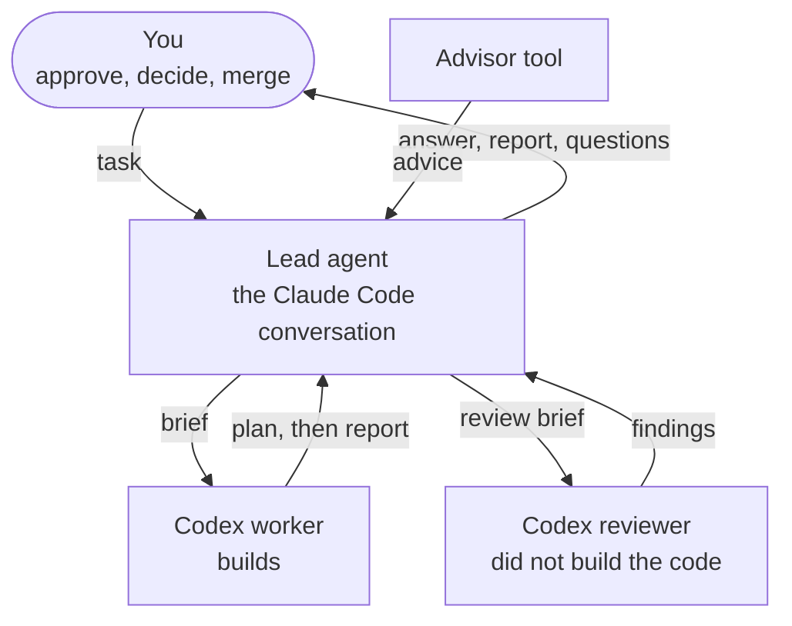
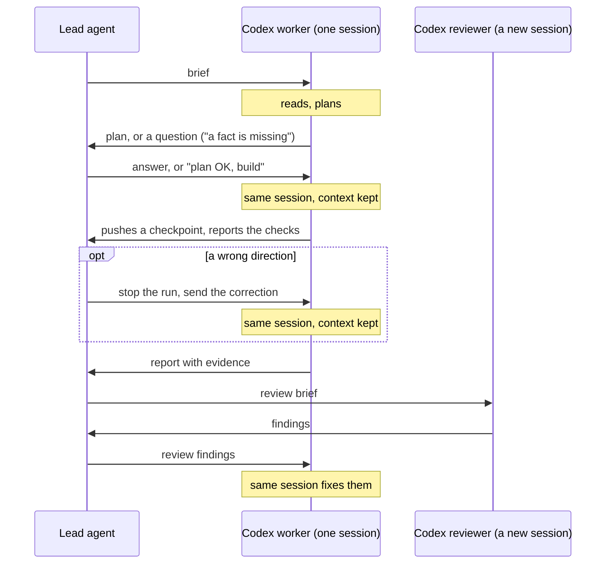

# Codex workers: guide for people

This file is for a person who wants to see how the skill works. An agent reads `SKILL.md`, which
holds the rules and the commands. This file adds no rule.

## What the skill does

You talk with one agent: the lead agent. It is the Claude Code conversation that you start.
The lead agent gives build work and review work to Codex workers, and it talks with them when that
is needed. You approve, you decide, and you merge.

## Who talks with whom

A worker and a reviewer send no messages to each other or to you. Each message passes through the
lead agent.

## One task, turn by turn

The review is a new session that did not build the code. Its findings go to the lead agent, and the
lead agent sends them to the session of the builder.

The lead agent also watches how full each worker's context window is. At 35% of the model's window,
the worker writes a handoff, the lead agent checks and corrects it, and a new worker continues from
it.

## How to start it

- Type `/codex-workers` in a conversation, or name the skill in your message.
- A skill that you started can also tell the lead agent to read `SKILL.md`.

No agent loads this skill by itself.
