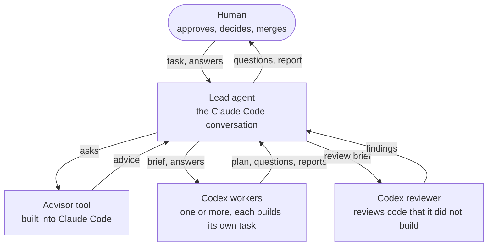
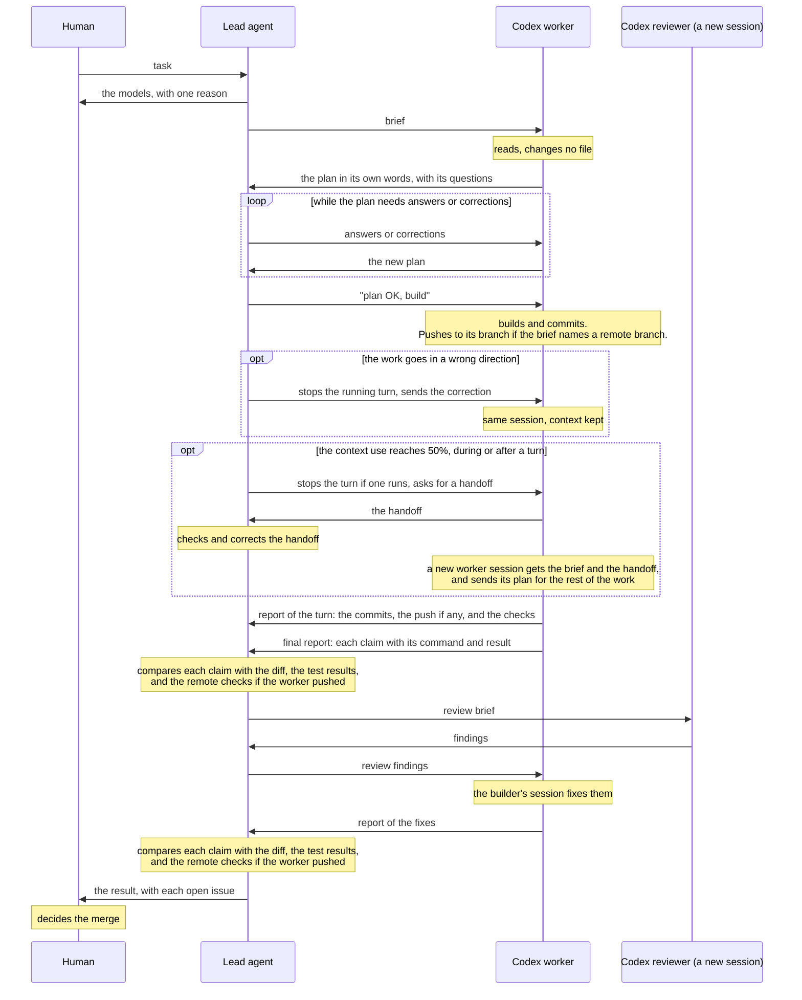

# Leader: guide for people

This file is for a person who wants to see how the skill works. An agent reads `SKILL.md`, which
holds the rules. This file adds no rule.

## How to start it

The skill keeps a human in the loop. The human starts a new conversation in Claude Code, and types
`/leader` with the task: the context, the goal, and what "done" means. From that message, the
conversation is the human's lead agent. No agent loads this skill by itself.

The lead agent keeps `goal.md` and `handoff.md` in its folder (default `tmp/leader/` in its
worktree), and gives the human the path in each report. To continue in a new conversation, the human
types `/leader` with that path.

## Who talks with whom



A worker and a reviewer send no messages to each other or to the human. Each message passes through
the lead agent. The lead agent can ask the advisor before it decides.

## The stages of a task, with the human's gates

```
 /leader <task>
      │
      ▼
 1 route ──▶ 2 read the project's rules ──▶ 3 questions ══▶ HUMAN answers (one round)
                                                  │
                                                  ▼
 4 plan and tests ══▶ HUMAN approves, if the project asks for it
      │
      ▼
 5 worker: plan in its own words ──▶ lead agent accepts ──▶ worker builds
   (see The lead agent's own work)
      │
      ▼
 6 lead agent checks the report ──▶ 7 a different agent reviews ──▶ fixes ──▶ lead agent
                                                                          checks the fixes
      │
      ▼
 8 report ══▶ the merge, only when the HUMAN asks for it
```

`══▶` is a gate: the work that depends on it waits for the human.

See [The lead agent's own work](SKILL.md#the-lead-agents-own-work) for step 5.

The lead agent also stops the work that depends on an item, and tells the human, when the documents
and the code disagree, when a bug does not reproduce, when a fix has the same cause as an earlier
fix, or when an approval is missing. Other work goes on.

## Who does which work

| Work | Who |
| --- | --- |
| Plans, briefs, records, messages to the human | The lead agent |
| [The lead agent's own work](SKILL.md#the-lead-agents-own-work) | The lead agent |
| Each other code change, also a simple one | A Codex worker |
| Each review | A different agent: a new session that did not build the code |

The rules for the worker are in `SKILL.md`. The templates for the briefs are in `references/`.

The [models](references/codex.md#pick-the-models) and the [commands](references/codex.md#commands) are in
`references/codex.md`.

## What the skill does

The human talks with one agent: the lead agent. It is the Claude Code conversation that the human
starts. The lead agent gives build work and review work to Codex workers, and it talks with them
when that is needed. The human approves, decides, and merges.

The lead agent's OK on a plan is not the human's approval. When the rules of the repository ask for
the human's approval, the lead agent stops and asks the human.

## One task, turn by turn



The diagram uses [Talk with the worker](SKILL.md#talk-with-the-worker) for the send command.

After each report, the lead agent compares each claim with the diff, the test results, and the
remote checks if the worker pushed.

The diagram does not show the points where the human approves, because each repository has its own
rules. At each of these points, the lead agent stops and asks the human.

Only the lead agent talks with the human. The review is a new session that did not build the code.
Its findings go to the lead agent, and the lead agent sends them to the builder's session. After a
handoff, that is the new session.

## Where the worker works

- The lead agent starts each worker in its own Git worktree and branch. The brief names the branch.
  If the brief has no branch name, a [Codex worker](references/codex.md#start) makes its own.
- A checkpoint is a point that the worker's plan names.
- A turn is one run of the worker: from a message of the lead agent to the report of the worker.
- If the brief names a remote branch, the worker pushes its commits to that branch at each
  checkpoint. It pushes to no other branch, and it does not force a push.
- A reviewer makes no commits.
- The lead agent splits the build into small tasks, so that each worker and each reviewer handles a
  small piece of work. It can run more than one worker at the same time, each on its own task, in
  its own worktree and branch. The turn diagram shows one of them. For a command that only one agent can
  run at a time, such as a heavy build, the lead agent tells them the order, or sends the second
  message after the first worker is done with that command.

## The 50% limit

The context window is the text that a model can hold at one time: the brief, the messages, and the
files that it read.

The lead agent watches how full the context window of each worker is.
When 50% of the model's window is used, the worker gives its handoff as its last message. The lead agent checks and
corrects it, and a new worker continues from it.

The limit applies to a reviewer too. Before each review starts, the lead agent splits it into parts,
by files or by checks, so that each part ends under 50%.

50% is the human's limit, and the human can change it.
