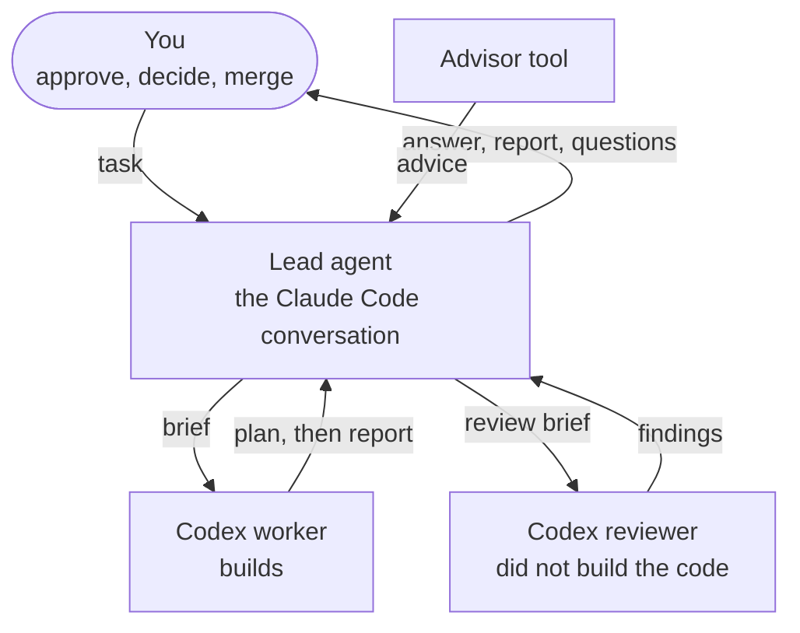

# Leader: guide for people

This file is for a person who wants to see how the skill works. An agent reads `SKILL.md`, which
holds the rules. This file adds no rule.

## How to start it

Start a new conversation in Claude Code, and type `/leader` with the task: the context, the goal,
and what "done" means. From that message, the conversation is your lead agent. No agent loads this
skill by itself.

## Who talks with whom



A worker and a reviewer send no messages to each other or to you. Each message passes through the
lead agent.

## The stages of a task, with your gates

```
 /leader <task>
      │
      ▼
 1 route ──▶ 2 read the project's rules ──▶ 3 questions ══▶ YOU answer (one round)
                                                  │
                                                  ▼
 4 plan and tests ══▶ YOU approve, if the project asks for it
      │
      ▼
 5 worker: plan in its own words ──▶ lead agent accepts ──▶ worker builds
      │
      ▼
 6 lead agent checks the report ──▶ 7 a different agent reviews ──▶ fixes
      │
      ▼
 8 report ══▶ YOU merge, when you ask for it
```

`══▶` is a gate: the work that depends on it waits for you.

The lead agent also stops and tells you when the documents and the code disagree, when a bug does
not reproduce, when a fix has the same cause as an earlier fix, or when an approval is missing.

## Who does which work

| Work | Who |
| --- | --- |
| Plans, briefs, records, messages to you | The lead agent |
| Written steps, an extraction, a summary | The lead agent |
| A code change below the line limit of `codex-workers` (step 1) | The lead agent; a different agent reviews it |
| Each other code change, also a simple one | A Codex worker |
| Each review | A different agent: a new session that did not build the code |

The models, the commands and the rules for the worker are in the `codex-workers` skill. The
templates for the briefs are in `references/`.
