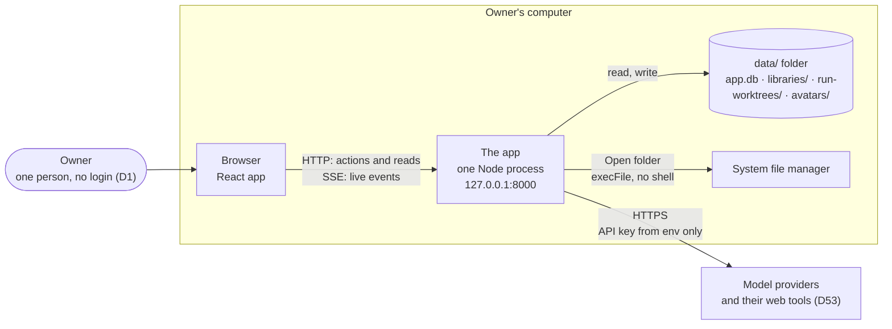
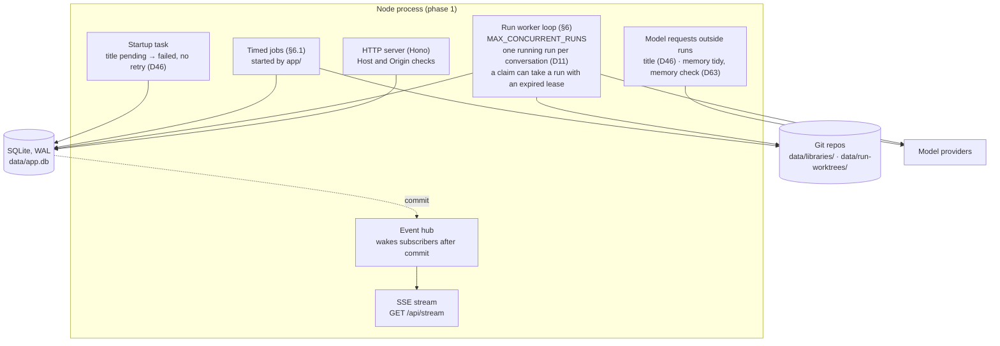
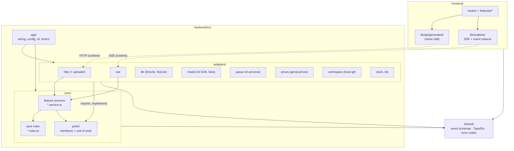
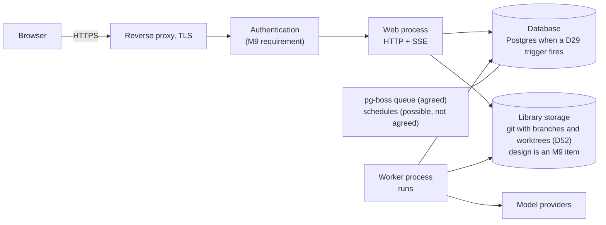

# Architecture

Stack (D34): TypeScript on Node 24 LTS for the backend, Hono for HTTP, Drizzle for the
database, the Vercel AI SDK (`ai`) for model calls; React + Vite for the frontend (D28); Zod
for every schema (D33). Libraries sit behind ports so they can be replaced (D35).

## 1. The big picture

These diagrams are views of the specification. Where a diagram leaves out or simplifies a rule,
the document that owns the rule wins. All diagrams are listed in [diagrams.md](diagrams.md).

### 1.1 System context



The browser talks only to the local backend. The backend makes outbound requests to the
configured model providers: bot runs, and also the model requests outside runs (auto title D46,
memory tidy and memory check D63). Bots reach external websites only through enabled
provider-hosted web tools (D53). The app does not fetch or parse websites itself.

### 1.2 Inside the process (phase 1)



The frontend is a React SPA. Vite serves it in development; the backend serves it as static
files in production builds. The browser uses the generated TypeScript client for HTTP and one
`EventSource` for SSE.

**What survives a restart.** Run state, leases and events live in SQLite. Library files and
unsaved run branches live on disk (`data/libraries/`, `data/run-worktrees/`, D52). Timers, open streams and event
notifications live in memory; the app creates them again at start, and the browser reconnects
with `Last-Event-ID` (`realtime-events.md`).

**Two different recovery rules.** They are not one retry mechanism:

- A title request that was `pending` when the app stopped becomes `failed` at start and is never
  retried (D46).
- A `running` run whose lease expired is claimed again by the worker, with `attempts + 1`, until
  it has had `RUN_MAX_ATTEMPTS` tries since its first claim or its last manual Retry (§6, §11).
  This is part of every claim, not a startup step.

## 2. Ports and adapters (D35)

The core says what it needs as an interface (a **port**); an **adapter** implements it with a
library. The core never imports a library that an adapter wraps, so changing the library
changes one adapter and nothing else.

| Port (`core/ports/`) | What the core asks for | Phase-1 adapter | Later or alternative |
| --- | --- | --- | --- |
| `transport.ts` | `subscribe(afterSeq) → AsyncIterable<Event>` turned into frames | `adapters/sse/` | WebSocket (`realtime-events.md` §1a) |
| `repositories.ts` | One repository per aggregate, plus `UnitOfWork.run(tx => …)` | `adapters/db/` (Drizzle, SQLite) | Drizzle on Postgres (D29) |
| `queue.ts` | Enqueue, claim with lease, finish, fail | `adapters/queue/in-process/` (rows in `runs`) | `adapters/queue/pg-boss/` |
| `model.ts` | Stream a reply with tools; report usage per request | `adapters/model/ai-sdk/`, `adapters/model/fake/` | Direct vendor SDKs |
| `prices.ts` | Price one request; say where the price came from | `adapters/prices/genai-prices/` + `config/models.yaml` override (D21) | Another price feed |
| `workspace.ts` | Resolve, read, write, commit, changed-since; open a place's folder in the file manager (`openFolder(place)`, `security.md` §2.15) | `adapters/workspace/local-git/` | Git on the VPS disk. The storage design is an M9 item: D52 needs branches, worktrees and merges, so plain object storage is not enough. A VPS adapter refuses `openFolder` |
| `clock.ts`, `ids.ts` | Now; new id of a given type: UUIDv7 (D22) written as a TypeID (D36) | System clock, `uuidv7` + `typeid-js` | Fixed values in tests |

**Unit of work.** A state change and the event describing it commit together (§5, rule 3 in
`AGENTS.md`). Services do both inside one `uow.run(tx => …)`; the repositories they get from
`tx` share the transaction. This is part of the persistence port, so a new database adapter
cannot quietly drop the guarantee.

**No port without a need (owner, 2026-10-28).** D35 rejects interfaces for every utility. A
capability gets a port only when a second implementation or a test needs it. These three stay
outside the port list, and each is built in the slice that needs it, not in M0:

| Capability | Where it lives | Slice |
| --- | --- | --- |
| Avatar check and re-encode with `sharp` (`security.md` §2.4) | `adapters/http/uploads/`. The bots service gets only the stored path | M2 |
| Timed jobs (Trash purge) | A timer that `app/` starts; it calls a core service with the time from the clock port (§6.1) | M1, then M5b |
| Open folder (`security.md` §2.15) | One method on the workspace port; the program starts in the local-git adapter | M6 |

The unit of work is the guarantee that matters most: a state change and its event commit
together.

**Contract tests.** Each port has one suite in `backend/test/contracts/<port>.contract.ts`.
Every adapter runs it (the SSE adapter and the fake model from M0). A new adapter is done when
it passes the suite.

**Not abstracted:** TypeScript, React, Zod and SQL beyond what Drizzle covers for SQLite and
Postgres. D35 explains why.

## 3. Components and their contracts

| Component | Owns | Must not |
| --- | --- | --- |
| `adapters/http/` | Hono routes (Zod schemas via `@hono/zod-openapi`), status codes, error mapping, middleware (Host/Origin, `secureHeaders`, `bodyLimit`, CORS in dev, Pino logging), avatar upload checks with `sharp` in `uploads/` | Contain business rules or SQL. A handler parses, calls one service, maps the result |
| `core/<feature>/*.service.ts` | Use cases: transactions through the unit of work, calling rules, appending events | Import Hono, Drizzle, `ai`, pg-boss or any adapter |
| `core/<feature>/*.rules.ts` | Decisions as pure functions (`decideRuns`, `budgetAfter`, `visibleHistory`, `parseMentions`) | Import ports, services, adapters or `Date.now()`; time comes in as an argument |
| `core/events/` | `appendEvent(tx, type, data)`; the hub that wakes subscribers after commit | Be called outside a unit of work that also changes state |
| `core/runs/` | The worker loop: claim through the queue port, leases, retries, cancellation, building the prompt, the bot's tools, writing the bot message | Decide who runs (that is `decideRuns`); touch files except through the workspace port |
| `core/catalog/` | The model catalog from `config/models.yaml`, availability (key present), effort per model | Store keys anywhere |
| `adapters/workspace/local-git/` | `resolve()` and the path sandbox, git commits, run branches, `openFolder` with `execFile` | Know about bots or conversations beyond ids and the Library root of the run |
| `adapters/db/` | Drizzle table definitions, repositories, the unit of work | Business logic |
| `app/` | `main.ts` (wiring, starts the timed jobs of §6.1), `config.ts` (env parsed with Zod), `cli.ts` | Logic of its own beyond wiring |

**Why the rules are pure.** Routing ("who runs next?") is where bugs hide: mentions, budgets,
pending members, deleted bots, branches. As a pure function it can be tested with hundreds of
table rows in milliseconds and read by a reviewer in one sitting. Services gather the state,
call the function, and act on the answer.

## 4. Repository layout

A pnpm workspace with three packages. Each folder marked † has a `README.md` index (§4.2).

```
.
├─ AGENTS.md                 rules for coding agents
├─ CLAUDE.md                 "@AGENTS.md"
├─ README.md                 what it is, quickstart
├─ PRODUCT.md, DESIGN.md     the Impeccable skill's snapshot of the brief and the theme
│                            (not a spec; workflow.md §2)
├─ .impeccable/              Impeccable settings and design.json (its hook cache is ignored)
├─ Makefile                  dev, test, lint, seed shortcuts
├─ package.json              workspace scripts (lint, typecheck, test, e2e, gen:api, check:index)
├─ pnpm-workspace.yaml
├─ .dependency-cruiser.cjs   import rules (§4.1)
├─ config/
│  └─ models.yaml            model catalog and price overrides
├─ docs/                     this specification
├─ seed/                     example skills and bots for `make seed` (seed/README.md)
├─ scripts/                  repository scripts: checks (check:index, check:events, check:bundle,
│                            lint:imports, db:check), gen:api, start (the production build),
│                            e2e:serve (the e2e servers, kept running)
├─ shared/ †                 code both sides import
│  └─ src/
│     ├─ events/             Zod schemas of the event envelope and every event type
│     ├─ ids.ts              TypeID schemas per prefix (BotId, MessageId, …; D36)
│     └─ errors.ts           API error codes
├─ backend/ †
│  ├─ package.json
│  ├─ drizzle.config.ts
│  ├─ migrations/            SQL generated by drizzle-kit, reviewed like code
│  ├─ src/
│  │  ├─ app/ †              main.ts, compose.ts, config.ts, database.ts, cli.ts (`ids decode`,
│  │  │                      `db migrate`; `skills import|export <folder>` from M1)
│  │  ├─ core/
│  │  │  ├─ ports/ †         one file per port (§2)
│  │  │  └─ <feature>/ †     bots, skills, conversations, messages, runs, handoffs, events,
│  │  │                      catalog, stats, projects (D37), memory (D38), library (D52, D61),
│  │  │                      trash (D62), settings, plans (D48, D54, D57), attachments,
│  │  │                      improve (D51): *.service.ts, *.rules.ts, *.test.ts
│  │  └─ adapters/
│  │     └─ <system>/ †      http, sse, db, log, ids, model, queue, prices, workspace, clock
│  └─ test/
│     ├─ contracts/ †        one suite per port, run by every adapter
│     ├─ api/                HTTP tests against the Hono app
│     ├─ security/           security.md §3
│     └─ fixtures/           fake-model scripts, seed data
├─ frontend/ †
│  ├─ package.json
│  ├─ src/
│  │  ├─ routes/ †           TanStack Router route tree (D28)
│  │  ├─ features/<feature>/ † conversation, bots, skills, settings, flow (flow-view.md), stats:
│  │  │                      components, hooks over the generated client, view state
│  │  ├─ components/ui/      shadcn/ui on Base UI (copied in, owned by us)
│  │  ├─ lib/api/ †          generated/ (never edit) and the client setup
│  │  ├─ lib/realtime/ †     transport.ts, sse.ts, event reducer (realtime-events.md §1a)
│  │  ├─ lib/ †              markdown renderer (sanitised), log.ts, timerange/, formatting
│  │  └─ themes/ †           token files per theme, variants.ts (D30, design/themes.md)
│  └─ test/
│     ├─ e2e/                Playwright
│     └─ security/
└─ data/                     runtime data (git-ignored)
```

Unit tests sit next to the code they test (`decide-runs.rules.test.ts`). File names are
kebab-case.

### 4.1 Import rules

Solid arrows are allowed imports; any other import fails CI. Dashed arrows are HTTP and SSE at
runtime, not imports: the frontend never imports backend code.



- `app/` may import anything in the backend. It is the only place adapters are chosen.
- `adapters/<system>/` may import `core/` (ports and types) and `shared/`. **Adapters never
  import each other**; if two need to cooperate, `app/` wires them.
- `core/` may import `core/ports/`, other core features' public files and `shared/`. Never an
  adapter, never Hono, Drizzle, `ai`, pg-boss, `better-sqlite3`, `node:fs` or `node:child_process`.
- `*.rules.ts` may import only other `*.rules.ts` files and `shared/`. A rules file sits in its
  feature folder, for example `core/plans/plan-progress.rules.ts` (D57) and
  `core/library/library-save.rules.ts` (D52).
- `frontend/` may import `shared/`, never `backend/`. It talks to the backend only through
  `lib/api/generated/`.

dependency-cruiser checks these in `pnpm lint`; a violation fails CI.

### 4.2 Folder indexes for agents

Each folder marked † in §4 has a `README.md` that indexes it, so an agent (or a person) can find
the right file by reading one short page instead of opening every file. `docs/README.md` does
the same for the documentation.

Format:

```md
# core/runs

Runs one bot's reply: claim, prompt, model call, tools, finish. Rules: architecture.md §6.

| File | What it is for |
| --- | --- |
| `worker.service.ts` | The loop: claim a run, execute it, release or fail it |
| `prompt.rules.ts` | Builds the prompt in the order of conversation-rules.md §4 |
| `tools.service.ts` | The bot's tools (files, skills, handoff) over the workspace port |

Start here: `worker.service.ts`. Do not: call the model except through the model port.
```

- One line of purpose, then a table with every file and subfolder in the folder (tests,
  `README.md` itself and `generated/` excepted), then where to start and what not to do.
- Descriptions say what a file is for, not what it contains line by line, so they change only
  when the purpose changes.
- **Kept current by CI.** `pnpm check:index` fails when a file or subfolder is missing from
  its folder's table, or when the table names something that no longer exists. Whether a
  description is still true is a review item in the PR template.
- **The same script checks the docs indexes.** It reads only fixed metadata, never prose:
  - every story id (`- **CV-8.**`) in `docs/requirements/*.md` is inside the range that
    `docs/requirements/README.md` gives for that file, and the last id of the range exists;
  - every `Amends:` and `Supersedes:` line in `docs/decisions/` names decisions that exist, and
    the "Changed by" column of `docs/decisions/README.md` lists exactly those entries;
  - every decision file has one index row, and every row links to a file that exists;
  - `docs/lessons-learned/README.md` lists every lesson file, like a folder index.
  Whether two decisions agree in meaning is not checkable; the reviewer checks it
  (`workflow.md` §4).
- Leaves only: the root `README.md` and this section link to the package indexes; there is no
  second, central file list to drift.

## 5. Events: what we do and don't do

"Event-driven" means different things; this app uses two of them.

| | Used | Why |
| --- | --- | --- |
| **Event log** (D9): every state change visible in the UI appends a row to `events` in the same transaction | Yes | Live UI, replay after reconnect, one source for the stream (`realtime-events.md`) |
| **Job queue**: runs are rows claimed with a lease (§6); pg-boss on Postgres later | Yes | Work survives restarts and moves to a separate worker without a redesign |
| **In-process domain events** (a service publishes "message created", another listens) | Optional, only inside one process and one transaction | Allowed when it removes a real coupling; not a framework |
| **Event bus** between services (Kafka, Redpanda, NATS) | No | One process, one database. Nothing to decouple across a network |
| **Event sourcing** (state rebuilt from events) | No | Tables are the source of truth; events describe changes for the UI |

If another system ever needs these changes (analytics, a second service), add an **outbox**:
a relay reads committed `events` rows and publishes them to Redpanda or NATS. The tables and
services stay as they are.

## 6. Runs, the worker, and concurrency

A **run** is one bot answering one trigger message. Lifecycle:

```
queued ──claim (lease)──▶ running ──▶ done
   │                         │ └────▶ failed   (after max attempts; system message shown)
   └──── stop ───────────────┴──────▶ stopped  (owner pressed Stop)
```

- Runs are rows in `runs`. The worker is a loop in the Node process (`core/runs/`, through the
  queue port): claim the oldest `queued` run whose conversation has no `running` run, set
  `locked_until = now + lease`, execute, finish.
- **One running run per conversation** (D11) is enforced by the database (a partial unique
  index and a compare-and-set claim, §11), not by locks in memory, so it survives restarts and
  a later multi-process worker.
- Different conversations run concurrently, up to `MAX_CONCURRENT_RUNS` (default 3).
- A crash leaves a `running` row with an expired lease. A worker reclaims it with its own
  compare-and-set (`attempts + 1`, §11). The limit counts the tries since the run's first claim
  or its last manual Retry, not all tries of the run (owner, 2026-10-29): a manual Retry gives
  the run `RUN_MAX_ATTEMPTS` tries again. When the run has used them
  (default 3), the worker does not reclaim it: the run becomes `failed` with
  `error = "lease_expired"`, and the message shows Retry (UI-3.7). `attempts` is also the
  fencing token that stops the old worker's late writes (§11).
- **Idempotency:** a run produces exactly one bot message; the message row is created when the
  run starts (status `streaming`) and reused on retry, so retries never duplicate messages.
- **Stall timeout:** the lease covers a crashed worker, not a provider that hangs. Each model
  request has a read timeout (`MODEL_REQUEST_TIMEOUT_SECONDS`), and as a backstop the worker
  fails a run that has had no `message.delta` and no `run.step` for `RUN_STALL_SECONDS`. Such a
  run ends `failed` with `error = "timed_out"`; the message shows Retry (UI-3.7). Timed-out runs
  are not retried automatically.
- **Stop:** marks queued runs `stopped`; for the running one, aborts it through an
  `AbortSignal` passed to the model port and checked between tool calls; the message keeps its
  partial text with status `stopped`.

### 6.1 Timed jobs

Timed jobs need no scheduler abstraction now (owner, 2026-10-28). `app/main.ts` starts one timer
per job. The timer calls a core service and passes the time from the clock port. Timers live in
memory, so each job also runs once at start; that run catches up on any time the app was off.

| Job | When | What it does | Slice |
| --- | --- | --- | --- |
| Trash purge (D49, D50, D60, D62) | At start and every `PURGE_INTERVAL_HOURS` (default 24) | Purges each item where `deleted_at + trash_days` is at or before now. One item per transaction, with its event | M1 (skills), M5b (every item) |
| Unsaved changes discard (D52) | The same job, the same interval | Discards each unsaved run branch at `discard_on`: the run's end `+ trash_days`, or the purge of its conversation or project, whichever comes first. Example: the run fails on Oct 1, the conversation goes to Trash on Oct 20, `trash_days` is 30: the changes go on Oct 31, the conversation on Nov 19 | M6 |

**Discard steps.** Git and SQLite cannot share a transaction, so the discard has two steps:

1. Database first, in one transaction: `UPDATE run_branches SET state = 'discarded' WHERE run_id = ?
   AND attempt = ? AND state = 'unsaved'`, with `library.discarded`. Save uses the same compare-and-set on
   `state = 'unsaved'`: it moves the row to `saving` before the merge. The loser changes 0 rows.
   A loser job skips the row; a loser Save returns 409 `nothing_unsaved`.
2. Then disk: remove the attempt's worktree and its branch. Every job pass and every start also
   removes the disk leftovers of `discarded` rows. A worktree or branch that is already gone
   counts as done, so a crash between the two steps leaves nothing behind.

**One branch per attempt (owner, 2026-10-28).** A Retry queues the same run again, and its new
try starts from the newest main; the failed try's changes stay (`design/components/library-cards.md`
§3). So each attempt has its own branch `runs/<run-id>/<attempt>`, worktree
`data/run-worktrees/<run_id>-<attempt>/` and `run_branches` row, keyed by `(run_id, attempt)`,
a foreign key to the try in `run_attempts` (`domain-model.md` §7).
Every save and discard names the attempt. A try that a lease reclaim replaces (§6, §11) is
treated like a failed try: if it wrote files, its branch becomes unsaved changes with its own
`discard_on`, and the reclaimed attempt starts a new worktree from the newest main.

The `saving` state and the `attempt` key are part of the M6 `run_branches` schema design
(owner, 2026-10-28).

Both jobs are idempotent: a second pass finds nothing. An item can stay up to one interval longer than
`trash_days`, never shorter (D62). On a VPS (§10) pg-boss schedules are one possible way to run
these jobs; that is not agreed.

## 7. Example flow: the owner sends "@BA write login stories"

1. Browser `POST /api/conversations/{id}/messages` with text and the mention token for BA.
2. The Hono route parses the body with its Zod schema and calls the messages service, which
   opens a unit of work:
   - checks BA is an `active` member (otherwise 422 `mention_not_member`);
   - inserts the human message (parent = current active leaf), updates
     `active_leaf_message_id`, resets `bot_turns_used` to 0;
   - calls `decideRuns(...)` → `[{ bot: BA, trigger: msg }]`;
   - inserts the run (`queued`) and events `message.created`, `run.queued`;
   - commits. The event hub wakes subscribers.
3. Response `201` with the message. The browser already shows it (optimistic) and reconciles.
4. The worker claims the run, emits `run.started`, creates the bot message (`streaming`), builds
   the prompt (persona, conversation rules block, pinned skills, visible history), and calls the
   model port.
5. Tokens stream as `message.delta` events (not persisted). Partial text is saved about once
   per second. Tool calls go through the workspace port; `load_skill` calls are recorded in
   `run_skills`.
6. On finish: message `complete`, run `done`, token counts saved, events `message.completed`
   and `run.finished`. Then `decideRuns` is called again for the bot's message (bot-to-bot,
   if enabled and budget remains).

## 8. Configuration

All configuration comes from environment variables (`.env` in development), parsed once at
startup by a Zod schema in `app/config.ts` (the process exits with a clear message if one is
invalid), plus `config/models.yaml`.

| Variable | Default | Meaning |
| --- | --- | --- |
| `DATA_DIR` | `./data` | Database, Libraries, run worktrees, avatars (`domain-model.md` §11) |
| `HOST` | `127.0.0.1` | `127.0.0.1` or `localhost` in phase 1: the addresses the Host check serves. Startup refuses `0.0.0.0`, any non-loopback address, and other loopback addresses (`::1`, `127.0.0.2`) |
| `PORT` | `8000` | |
| `ALLOWED_ORIGINS` | `http://127.0.0.1:5173,http://localhost:5173` | Dev frontend origins; prod build is same-origin |
| `MAX_CONCURRENT_RUNS` | `3` | Across conversations |
| `RUN_LEASE_SECONDS` | `900` | |
| `RUN_MAX_ATTEMPTS` | `3` | Tries of a run since its first claim or its last manual Retry, lease reclaims included (§6) |
| `RUN_STALL_SECONDS` | `600` | No delta and no step for this long → run fails as `timed_out` |
| `MODEL_REQUEST_TIMEOUT_SECONDS` | `300` | Read timeout per model request |
| `TITLE_REQUEST_TIMEOUT_SECONDS` | `20` | Timeout of the one auto title request (D46) |
| `PURGE_INTERVAL_HOURS` | `24` | How often the Trash purge job looks for items past `deleted_at + trash_days`; it also runs at start (D62). It does not change how long Trash keeps an item |
| `IMPORT_PREVIEW_MINUTES` | `15` | How long the server keeps a skill import preview in memory (`domain-model.md` §3.5) |
| `IMPORT_PREVIEW_MAX` | `5` | Previews kept at once; a new one drops the oldest |
| `APP_ENV` | `dev` | `dev`, `test` or `prod`: app behaviour (OpenAPI docs page only in `dev`, test routes only in `test`) |
| `FAKE_MODEL` | `0` | `1` wires the fake model and the `fake:scripted` catalog entry (`testing.md` §2) |
| `LOG_LEVEL` | `info` | A Pino level: `fatal`, `error`, `warn`, `info`, `debug`, `trace` or `silent` |
| `<PROVIDER>_API_KEY` | none | Names referenced by `config/models.yaml` |

`NODE_ENV` is about build and runtime optimisation (`security.md` §2.10); `APP_ENV` is about app
behaviour. Startup refuses `APP_ENV=test` together with `NODE_ENV=production`, so test routes
never run in a production build (owner, 2026-10-30).

With `NODE_ENV=production` the backend also serves the built frontend (`frontend/dist`, from
`pnpm build`) on its own address, and stops at start when the build is missing. `pnpm start`
(or `make start`) builds and starts it in one command; `make dev` runs the Vite dev server,
which forwards `/api` to the backend (M0c).

## 9. Observability

- Structured JSON logs with Pino (one line per event) with `conversation_id`, `run_id`,
  `bot_id`. Never log message content at `info`; never log keys (a redaction list in the logger
  config).
- Every run stores model, effort, token counts, duration, attempts, error. A later milestone can
  build a cost view on this table; the data is captured from day one.
- `GET /api/health` returns DB reachability, worker alive, and catalog status.
- Metric `db_lock_wait_seconds` (histogram) around every write transaction: the input to D29's
  switch trigger 3.

## 10. Path to the VPS phase (not built now)

This diagram shows one possible topology, not a commitment. M9 designs it.



The design keeps these doors open:

| Later need | Why it is cheap |
| --- | --- |
| Separate worker process | Runs are claimed from the DB with leases, not held in memory |
| Postgres (D29 triggers: more than one human, or more than one process writes, or the lock or statistics limits) | The guardrails below; a Drizzle adapter for Postgres behind the same port |
| Durable job queue | `adapters/queue/pg-boss/` behind the queue port, passing its contract suite |
| WebSocket | A second transport adapter; event contract stays (`realtime-events.md` §6) |
| Rate limiting | `hono-rate-limiter` middleware in the HTTP adapter (M9) |
| Multi-user | `author_id`/`created_by` already stored; skills already have authors |
| Authentication | Required in M9: the no-login rule (D1) is safe only on 127.0.0.1 and does not carry over to a server that others can reach |
| Library storage | Not cheap: D52 needs git history, a worktree per run, merges and conflict handling. Plain object storage keeps none of these, so M9 designs the storage |
| Docker deployment | Everything configured by env vars; data in one directory |

Database guardrails, enforced in review from M0 (D29):

1. Drizzle's query builder only; no SQLite-only SQL in repositories (no `strftime`, no
   `INSERT OR REPLACE`; use Drizzle's `onConflictDoUpdate`).
2. Portable types: UUIDs as `TEXT` on SQLite and `uuid` on PostgreSQL behind one column helper;
   timestamps in UTC.
3. Migrations generated by drizzle-kit and committed as SQL; on SQLite, drizzle-kit rebuilds a
   table for changes `ALTER TABLE` cannot do, so each generated migration is read before merge.
4. Time bucketing for statistics behind one function (`core/stats/buckets.rules.ts`), so
   PostgreSQL's `date_trunc(..., time zone)` can replace it.
5. From M9: CI runs the tests on PostgreSQL too, and the event stream tolerates commits that
   land out of `seq` order (`realtime-events.md`).

## 11. Concurrency rules

**Principle: the database decides who wins.** Two requests, two browser tabs or two workers can
act on the same row at the same moment. Code never reads a row, checks it in TypeScript, and
then writes, because another writer can change the row in between. Each rule below makes the
write itself carry the check, so the loser finds out from the result (0 rows, a constraint
error) and handles it.

| Race | Rule | The loser gets |
| --- | --- | --- |
| Two workers claim the same queued run | Compare-and-set: `UPDATE runs SET status = 'running', locked_until = ?, attempts = attempts + 1 WHERE id = ? AND status = 'queued'` | 0 rows: picks another run |
| Two workers reclaim the same run after its lease expired (§6) | Compare-and-set: `UPDATE runs SET locked_until = ?, attempts = attempts + 1 WHERE id = ? AND status = 'running' AND locked_until < ? AND attempts - (SELECT max(attempt) FROM run_attempts WHERE run_id = runs.id AND started_by <> 'reclaim') + 1 < ?` (now, `RUN_MAX_ATTEMPTS`): the tries since the first claim or the last manual Retry (`domain-model.md` §7). The status stays `running`, so the partial unique index still holds | 0 rows: picks another run. The old worker's writes carry the old `attempts`, so they change 0 rows |
| A run with an expired lease has used all its attempts | Compare-and-set in one transaction: `UPDATE runs SET status = 'failed', error = 'lease_expired' WHERE id = ? AND status = 'running' AND locked_until < ? AND attempts - (SELECT max(attempt) FROM run_attempts WHERE run_id = runs.id AND started_by <> 'reclaim') + 1 >= ?`, then the message becomes `failed`, with `run.finished` and `message.failed` | 0 rows: another worker already ended it; nothing more to do |
| Two runs start in one conversation (D11) | Partial unique index `runs_one_running ON runs(conversation_id) WHERE status = 'running'`, so the claim above fails even if the "no running run" check raced | Constraint error: treated as 0 rows |
| A worker whose lease expired keeps writing after another worker reclaimed the run | `attempts` is a **fencing token**: every write a worker makes for a run (partial text, steps, finish) adds `AND attempts = <its attempt>` | 0 rows: the worker stops and discards its result |
| Stop and finish at the same moment | Both are compare-and-set on `status = 'running'` (with the fencing token) | Whichever commits second changes 0 rows; the run ends either `stopped` or `done`, never both |
| The same message sent twice (retry, double click) | Unique index `(conversation_id, client_id)` | The insert fails; the API returns the existing message with 200 (`api.md` §5) |
| Two sends in one conversation pick the same parent | The insert transaction locks the conversation first (below), reads `active_leaf_message_id`, inserts, moves the leaf | Waits, then sees the new leaf: messages chain instead of forking by accident |
| Bot turn counter at the limit (D4) | `UPDATE conversations SET bot_turns_used = bot_turns_used + 1 WHERE id = ? AND bot_turns_used < ?` | 0 rows: no run is queued; the "limit reached" notice is posted |
| Two tabs edit the same bot, skill metadata or conversation settings | **Optimistic locking**: the row has `row_version`; the PATCH sends the version it read; `UPDATE … SET …, row_version = row_version + 1 WHERE id = ? AND row_version = ?` | 0 rows: 409 `stale_write`; the UI reloads the row and shows what changed |
| Two saves create skill version N+1 | `UNIQUE (skill_id, version)` plus `base_version` in the request (`api.md` §2) | 409 `stale_write` |
| Two bots created with the same name or slug | Unique indexes on slug and on live name | 409 `slug_taken` / `name_taken` |

**State change and event together.** Every rule above runs inside the unit of work (§2), and
the event for the change is inserted in the same transaction (rule 3 in `AGENTS.md`), so a
loser's rolled-back transaction leaves no event. Event order uses the global `events.seq`
(`realtime-events.md` §5); there is no per-conversation counter, because the one stream and its
`Last-Event-ID` cursor cover all conversations.

**Transactions per database.**

- **SQLite (phase 1):** WAL mode, `busy_timeout = 5000`, and every write transaction starts
  with `BEGIN IMMEDIATE`, so it takes the write lock up front. That serialises writers, which
  is what "lock the conversation" means here. Reads never block.
- **Postgres (D29):** the same statements work unchanged. Where a transaction must read and
  then write the same row (the send above), it uses `SELECT … FOR UPDATE` on the conversation.
  The queue adapter on pg-boss claims jobs with `SKIP LOCKED`.
- Retry on a busy or serialisation error happens once, inside the unit of work. Business-level
  losers (0 rows, constraint errors) are never retried blindly; they map to the outcome in the
  table.

**Tests.** Each race in the table has a test that fires the competing operations at the same
time and asserts exactly one winner and a correct outcome for the loser:

- duplicate `client_id` sends → one message, both responses carry it;
- two workers claiming one run, and two runs in one conversation → one `running`;
- a stale worker writing after a reclaim → its writes change nothing;
- Stop racing finish → one final status, one event;
- two concurrent PATCHes with the same `row_version` → one 200, one 409.

The tests for the unit of work and the queue live in the contract suites
(`backend/test/contracts/`), so they run against SQLite now and Postgres from M9. Tests at the
service and API level run against SQLite.
