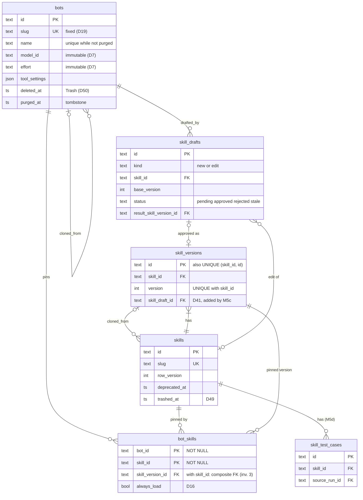
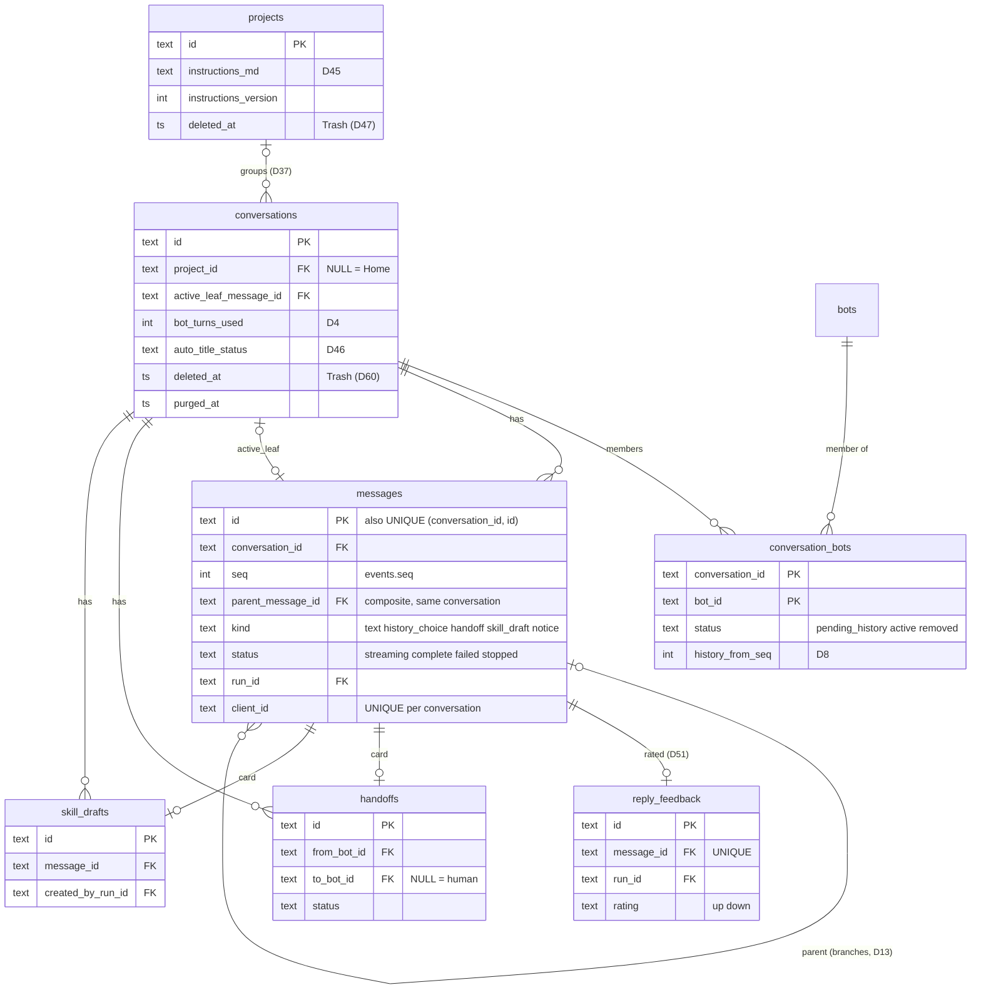
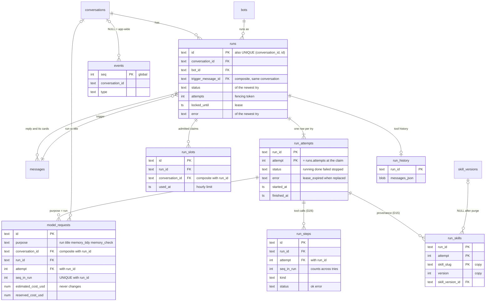
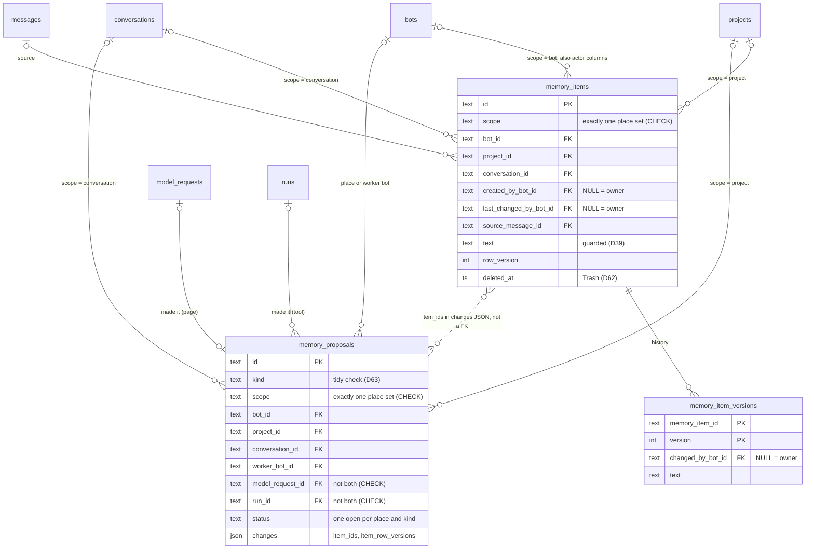

# Domain model and storage

This document owns the database schema, the invariants, and what lives on disk. Migrations must
match it; a PR that changes a table changes this document too (and needs the owner's review).

As of 2026-10-25, no application data exists, so no backfill is currently required. Constraints,
defaults, delete rules, and version history still apply. Each slice adds its tables and columns
to the initial schema for that slice. The owner approves a schema change in two steps: the schema
design in this document first, then the generated SQL in the slice PR (`../AGENTS.md` §7).

## 1. Conventions

- Ids are UUIDv7 (D22), stored as `TEXT` (36 chars) in SQLite and as native `uuid` in Postgres
  later: unique and sortable by creation time. Outside the database they are TypeIDs with a
  prefix per table (`bot_01jb…`, D36); the db adapter converts, nothing else does. Generated by the ids port (`core/ports/ids.ts`),
  implemented with the `uuidv7` package.
- Timestamps are UTC, stored as ISO-8601 `TEXT` (with `Z`) through one Drizzle column helper, so
  Postgres can map it to `timestamptz` later.
- Soft deletion uses `deleted_at` (bots) or `deprecated_at` (skills). Nothing that a message or
  run refers to is ever hard-deleted, with one exception: the Trash purge of a skill (D49, §3.4).
  Runs keep a copy of the skill's slug and version for this case (§3.7).
- Actor columns (`author_id`, `created_by`) hold the owner's user id. In phase 1 this is the
  constant `"owner"`; the column exists so multi-user is an addition (D1).
- JSON columns are validated by Zod schemas in the services before writing and parsed again
  when read.
- **Every primary key column is declared `NOT NULL`** (owner, 2026-10-28), also a single `id TEXT
  PK`. SQLite allows NULL in a primary key column that is not `INTEGER PRIMARY KEY`, unless the
  table is `STRICT` or `WITHOUT ROWID`. The schema test checks every primary key column.
- **Links inside one conversation use composite foreign keys** (owner, 2026-10-28). `messages`
  and `runs` have `UNIQUE (conversation_id, id)`, and a link from a row of a conversation to a
  message or run of the same conversation includes `conversation_id`, so the database refuses a
  link into another conversation. A composite key with a NULL column is not checked, so an
  optional link (a root message's parent, an empty leaf) still works. A future link that must
  point into another conversation on purpose (for example D58's Send to conversation) uses a
  plain foreign key and says why.
- SQLite runs in WAL mode with `foreign_keys=ON` and `busy_timeout = 5000`; writes use
  `BEGIN IMMEDIATE` (`architecture.md` §11).
- Rows edited from forms (`bots`, `skills`, `conversations`) carry `row_version INTEGER NOT NULL
  DEFAULT 1` for optimistic locking; a stale write returns 409 `stale_write`
  (`architecture.md` §11).

## 1a. Diagrams by domain

These ERDs show the keys and the columns that carry a rule (owner review, 2026-10-28 and
2026-10-29). The tables in the sections below stay the full schema; where a diagram leaves out
a column or a rule, the section wins (`diagrams.md`).

### ERD 1: bots and skills (§2, §3, §15)

A pin is one row per bot and skill (D6). A version is never updated. The latest version is the
highest `version`. A composite foreign key keeps each pin inside its skill.



### ERD 2: projects, conversations and messages (§5, §6, §9, §14, §15)

Messages form a tree per conversation (D13). Links inside one conversation use composite
foreign keys (§1). Cards read their state from `handoffs` and `skill_drafts`.



### ERD 3: runs, usage and events (§7, §3.7, §3.8, §8)

One running run per conversation (D11). One `run_attempts` row per try; steps, requests and
skills used name their try. Cost lives on each model request; run totals are sums (D21).



### ERD 4: memory (§14)

One table for the three scopes, with a CHECK that exactly one place is set (D38). One open Tidy
or check card per place and kind (D63). A card names its items inside `changes`, not by a
foreign key.



## 2. Bots

```
bots
  id                   TEXT PK
  slug                 TEXT UNIQUE NOT NULL          -- fixed at creation (D19)
  name                 TEXT NOT NULL                 -- ≤ bot_name_max (32) chars; unique among bots not purged, Trash included (D50)
  description          TEXT NOT NULL                 -- one line, ≤ bot_description_max (160) chars, shown to other bots (team directory, D18)
  persona_md           TEXT NOT NULL                 -- ≤ bot_persona_max (8,000) chars
  avatar_style         TEXT NOT NULL DEFAULT 'flat'  -- flat | jelly | pixel | upload (bot-avatar.md)
  avatar_colour        TEXT NOT NULL                 -- any colour as '#RRGGBB' (bot-avatar.md §5); the Create page picks the default; the backend does not know the palette
  avatar_path          TEXT NULL                     -- data/avatars/<sha256>.webp when avatar_style = 'upload', else NULL
  model_id             TEXT NOT NULL                 -- catalog id, e.g. anthropic:<model-name>        (immutable, D7)
  effort               TEXT NULL                     -- one of the model's efforts, NULL if none       (immutable, D7)
  request_limit        INTEGER NOT NULL              -- model requests per run; default from setting bot_default_request_limit (30)
  max_reply_chars      INTEGER NOT NULL              -- default from setting bot_default_max_reply_chars (6000)
  history_share_pct    INTEGER NOT NULL              -- % of the model's context window for history per run, step 5 (D32); default bot_default_history_pct (40), range bot_history_min_pct–bot_history_max_pct (10–80)
  tool_settings        JSON NOT NULL                 -- {<tool_id>: true | false} for every tool in the catalog that this bot's model can use (§4.1, D55)
  cloned_from_bot_id   TEXT NULL REFERENCES bots(id)
  create_key           TEXT NULL UNIQUE              -- Idempotency-Key of POST /bots; a repeat returns this bot (bots.md UI-5.6)
  create_request_hash  TEXT NULL                     -- SHA-256 of the canonical POST /bots body; set with create_key (§2 Idempotency)
  pinned_position      INTEGER NULL                  -- 1 = first pinned bot; NULL = not pinned (design/components/pin.md, bots.md UI-4.5)
  created_by           TEXT NOT NULL
  created_at, updated_at
  deleted_at           TIMESTAMP NULL                -- soft delete (D12); with D50 this is "moved to Trash"
  purged_at            TIMESTAMP NULL                -- D50: Trash purge; the row stays as a record (name, slug, avatar, colour) for old messages

CHECK (purged_at IS NULL OR deleted_at IS NOT NULL)
CHECK ((create_key IS NULL) = (create_request_hash IS NULL))
UNIQUE INDEX bots_name_kept ON bots(lower(name)) WHERE purged_at IS NULL
UNIQUE INDEX bots_pinned_position ON bots(pinned_position) WHERE pinned_position IS NOT NULL
```

- `multimodal` is not stored on the bot: it is a property of the model in the catalog.
- **Immutability (D7):** the update schema has no `model_id` or `effort` fields and forbids
  extra fields, so a PATCH containing them returns 422. A test proves the row is unchanged.
- **Write rule:** bots have no per-bot write folders. A bot writes only in the Library that its
  run saves to, anywhere except `attachments/` and `.git` (D52, `security.md` §2.3).
- **Idempotency (UI-5.6):** POST /bots stores the `Idempotency-Key` in `create_key` and the
  SHA-256 of the canonical request body in `create_request_hash`, in the same transaction as the
  insert. Canonical body: the parsed body after Zod validation, before defaults are applied, as
  JSON with sorted keys and no spaces. A repeat with the same key and the same hash returns the
  first bot (200) and creates nothing. The same key with another hash returns 409
  `idempotency_key_reused`. Keys stay with the bot row; a purge clears them (below).
- **Purge (D50):** after `trash_days`, the purge job turns the bot row into a **tombstone** in one
  transaction. Every column keeps its value, except these, which change so the NOT NULL columns
  still hold: `description = ''`, `persona_md = ''`, `tool_settings = '{}'`,
  `pinned_position = NULL` (already NULL since the delete), `create_key = NULL`,
  `create_request_hash = NULL`, `memory_history_versions = NULL` (its memory is deleted below),
  `updated_at = now` and `purged_at = now`. This list is closed: a column added later keeps its
  value unless this rule names it. The kept values (for example `name`, the avatar columns,
  `model_id`, `effort`, `request_limit`, `max_reply_chars`, `history_share_pct`) are never used
  again for a run. In the same
  transaction it deletes
  the bot's `bot_skills` rows, its bot-scope `memory_items` with their `memory_item_versions`, and
  the bot's open skill drafts (`skill_drafts` with `drafted_by_bot_id` = the bot and no decision).
  Rows that record history stay and keep their foreign keys: messages, runs, run steps,
  `conversation_bots` (status `removed`), handoffs, `reply_feedback`, decided skill drafts. The
  avatar file stays, because old messages show it. A tombstone is never updated again and never
  restored.
- **Clone:** there is no "clone" write endpoint. `GET /bots/{id}/clone-template` returns a
  prefilled create payload (`name` per the clone name rule below, description, persona, avatar style (no
  colour: the page picks a free one, `design/components/bot-avatar.md` §5), model, effort, Advanced values, `tool_settings`, pins with their versions and
  `always_load`). The owner edits it in the create form and submits a normal create with
  `cloned_from_bot_id`. Cancelling creates nothing. Bot memory is not copied. A bot in Trash or
  purged has no clone template (422 `bot_deleted`).
- **Clone name:** the template name is "{name} (copy)". If that is longer than `bot_name_max`,
  the base name is cut at a character boundary (never inside a grapheme) and trailing spaces
  are removed, so the whole name fits: for a limit of 32, the base keeps at most 25 characters.
  If the name is taken (Trash included), the template tries "{base} (copy 2)", "(copy 3)", …,
  cutting the base again for each, and returns the first free one. It is only a suggestion: the
  owner can change it, and the create checks it again (409 `name_taken`).
- **Order** (`bots.md` UI-4.5, `app-shell.md` UI-2.1): pinned bots first, by `pinned_position`
  ascending; then the others by `settings.bot_order` and `settings.bot_order_direction`. With
  `'recent'` the order comes from `last_activity_at`, computed on read as the latest
  `created_at` of the bot's messages and runs (bots with no activity follow, by `created_at`);
  nothing is stored for it. With `'created'` it is `created_at`. Saving the pinned list
  (`PUT /bots/pins`) rewrites `pinned_position` in one transaction: every bot gets NULL first,
  then the listed bots get 1…n, so the unique index never sees a duplicate. A delete sets `pinned_position` to NULL and closes the gap in the same
  transaction.
- **Tool settings (D55):** at create, each internal tool is on and each provider tool
  is off, unless the request says otherwise. For two tools with the same `job` (§4.1), at most one
  is on; the service rejects a body that turns on both (422 `tool_job_conflict`). Provider tool
  switches have effect only from the milestone that builds them (D53).
- **Health** (`bots.md` UI-4.6) is computed on read from runs and pins; nothing is stored.
- **Availability** is computed, not stored: a bot is *available* if its `model_id` is in the
  catalog and the model's API key variable is set.

## 3. Skills

### 3.1 Tables

```
skills
  id                             TEXT PK
  slug                           TEXT UNIQUE NOT NULL     -- Agent Skills name rule, see "Slug" below
  name                           TEXT NOT NULL            -- display name, not versioned; ≤ skill_name_max (§10)
  author_id                      TEXT NOT NULL            -- D14
  cloned_from_skill_version_id   TEXT NULL REFERENCES skill_versions(id)
  row_version                    INTEGER NOT NULL DEFAULT 1   -- §1; every write to this row raises it; form writes check it (api.md §2)
  created_at
  updated_at                                              -- last change (rename, new version, deprecate, undeprecate, trash, restore); list order
  deprecated_at                  TIMESTAMP NULL
  trashed_at                     TIMESTAMP NULL           -- in Trash (D49); set only when deprecated_at is set
  trashed_bot_ids                JSON NULL                -- bots that used it at delete time, for the restore suggestion

skill_versions                                            -- no UPDATE; DELETE only by the Trash purge (D49)
  id            TEXT PK
  skill_id      TEXT NOT NULL REFERENCES skills(id)
  version       INTEGER NOT NULL                          -- 1, 2, 3 … per skill
  description   TEXT NOT NULL                             -- ≤ 1,024 chars, required, shown to the bot
  body_md       TEXT NOT NULL                             -- ≤ skill_body_max (§10) chars, required
  changelog     TEXT NULL                                 -- one line, optional
  created_by    TEXT NOT NULL
  skill_draft_id TEXT NULL REFERENCES skill_drafts(id)    -- set when approved from a bot's draft (D41); M5c adds it, see below
  created_at
  UNIQUE (skill_id, version)                              -- also finds the latest version: the highest one
  UNIQUE (skill_id, id)                                   -- target of the bot_skills composite foreign key

bot_skills                                                -- a bot's "go.mod"
  bot_id            TEXT NOT NULL REFERENCES bots(id)
  skill_id          TEXT NOT NULL REFERENCES skills(id)
  skill_version_id  TEXT NOT NULL                         -- the pin (D6)
  always_load       BOOLEAN NOT NULL DEFAULT FALSE                 -- D16
  added_at, updated_at
  PRIMARY KEY (bot_id, skill_id)                          -- one version of a skill per bot
  FOREIGN KEY (skill_id, skill_version_id) REFERENCES skill_versions(skill_id, id)   -- the pinned version belongs to this skill (invariant 3)
```

`name`, `description` and body follow the `SKILL.md` format:

```markdown
---
name: write-user-stories
description: Write docs/stories.md as user stories with acceptance criteria.
---

# Write user stories
...
```

The frontmatter `name` is the slug. `description` is per version (it can improve over time).
The display `name` is not in `SKILL.md` and is not versioned: a rename changes `skills.name` and
creates no version. So an export and a re-import into another app lose a custom display name
(§3.5).

**Slug (M1 spec gap pass, owner 2026-10-30).** The slug follows the Agent Skills `name` rule: 1–64
characters, lowercase letters, digits and hyphens, no hyphen at the start or the end, no `--`
(`^[a-z0-9]+(-[a-z0-9]+)*$`, length ≤ 64). These are format rules, fixed in code, so an export is
always a valid skill folder. The slugs `new` and `import` are reserved (they are page URLs,
`design/components/skills-page.md` §1); every create path refuses them: the editor, Clone,
import, a bot's draft (D41) and the seed. The slug is fixed after Create (D19).

**Columns added by later slices.** `skill_versions.skill_draft_id` comes with `skill_drafts` in
M5c, as `ALTER TABLE … ADD COLUMN … REFERENCES skill_drafts(id)` with a NULL default, which
SQLite allows (owner, 2026-10-30). M1 creates neither the column nor an empty `skill_drafts`
table. `bot_skills` comes with `bots` in M2.

**Latest version (owner, 2026-10-28).** A skill has no pointer to its latest version. The latest
version is the row with the highest `version` for the skill, found through
`UNIQUE (skill_id, version)` (`ORDER BY version DESC LIMIT 1`). This is always correct, because
versions are never updated and a Restore also creates `N+1` (§3.2). It also removes a circular
foreign key between `skills` and `skill_versions`, which needs deferred checks that SQLite and
Postgres declare in different ways (D29 guardrail 1).

- **Create:** the `skills` row and its v1 are inserted in the same transaction, so a committed
  skill always has at least one version (invariant 25).
- **Two saves at once:** the request sends `base_version`; the insert of `N+1` fails on
  `UNIQUE (skill_id, version)` for the loser, which gets 409 `stale_write` (`api.md` §2,
  `architecture.md` §11). Unchanged.
- **Pins:** the composite foreign key keeps each pin inside its skill (invariant 3).
  `bot_skills.bot_id` and `bot_skills.skill_id` are declared `NOT NULL`, because SQLite does not
  always enforce NOT NULL on the columns of a composite primary key, and a NULL would skip the
  foreign key check.

### 3.2 Versions and pins (D6)

The mental model is Go modules: a skill is a module, a version is a release, and a bot's pin
is its `go.mod` line.

| Action | Effect |
| --- | --- |
| Author saves an edit | New `skill_versions` row `N+1`, which is now the latest. **No pin moves.** |
| Save dialog "Also upgrade these bots" | Lists the author's bots pinned to older versions, all ticked. Ticked ones move to `N+1` in the same transaction. |
| Assign a skill to a bot | Pins the latest version (the highest `version`) at that moment. |
| Upgrade / downgrade on bot detail | Moves that one pin to the chosen version. |
| Restore old version vK | Creates `N+1` with vK's content (history is append-only). |
| Clone a bot | Copies pins and `always_load` exactly. |
| Import from folder | Creates new versions only; never moves pins. |
| Run starts | Uses the pins as they are at that moment; later changes do not affect a running run. |

Why integers and not semver: compatibility of prose cannot be checked by a machine, so
"major/minor/patch" would be a guess. The changelog line carries the human meaning.

### 3.3 Authorship and cloning (D14)

- Only `author_id` may create versions, edit metadata, deprecate or un-deprecate. Others get 403.
- Anyone may clone. Clone saves nothing: it opens the New skill editor filled from the version
  being viewed (name + " (copy)", slug `<slug>-copy`, both editable). Create makes a new skill
  (author = cloner, v1, `cloned_from_skill_version_id` set). No sync later.
- In phase 1 the owner authors everything, so the 403 path is exercised only by tests. It is
  built now because adding ownership later means rewriting every skill endpoint.

### 3.4 Deprecate, then delete through Trash (D49)

- **Deprecate** sets `deprecated_at`: hidden from the hub's default list and from "Add skills"
  pickers. In the same transaction it removes the pins of the bots the author ticked. Bots
  that keep it keep working and show a "deprecated" badge. Reversible by the author.
- **Delete** is only for a deprecated skill, also while bots use it. In one transaction it
  writes the bot ids of all its pins to `trashed_bot_ids`, deletes those `bot_skills` rows and
  sets `trashed_at`. The skill and all its versions are one Trash item.
- **In Trash:** the skill is in no list or picker, and its slug stays taken, so a restore
  always works. **Restore** clears `trashed_at`; the skill stays deprecated. The app then
  suggests to assign it again to the bots in `trashed_bot_ids` that are not deleted.
- **Purge:** after `trash_days` (§10), or **Delete** on the Trash page (D62), the app deletes the
  `skill_versions` rows and the `skills` row. Before that, in the same transaction, it sets
  `run_skills.skill_version_id`, `skills.cloned_from_skill_version_id`,
  `skill_drafts.skill_id` and `skill_drafts.result_skill_version_id` to NULL where they point
  to it. Each slice adds its own table to this step when it creates the table: M1 clears
  `skills.cloned_from_skill_version_id` only, M3 adds `run_skills`, M5c adds `skill_drafts`. The slug is then free for a new skill. Old runs show the copy in `run_skills`
  ("write-user-stories v4 (deleted)") and never link to a new skill with the same slug.

### 3.5 Import and export (D5)

Folder layout (also the zip layout):

```
skills/
  write-user-stories/SKILL.md
  interview-stakeholder/SKILL.md
```

Import (UI: upload a zip or choose a folder; CLI: `app skills import <folder>`):

The UI takes a zip; only the CLI reads a folder.

1. **Preview** (no writes): for each `<slug>/SKILL.md` → `new`, `changed` (with a diff against
   the latest version), `unchanged`, or `invalid` (with the reason: bad frontmatter, slug
   mismatch, a slug that breaks the slug rule or is reserved (§3.1), too large, not UTF-8, a
   likely secret (D39, `security.md` §2.13)). Skills authored by someone else are
   `conflict: not author`. A slug of a skill in Trash is `conflict: in Trash`. A slug of a
   deprecated skill is `conflict: deprecated` ("Deprecated. Make it active again to import.").
   Files other than `SKILL.md` are listed as skipped and never read (bots cannot run code).
2. **Apply** (after confirmation): for the rows the owner ticked (all by default), `new` →
   create skill v1; `changed` → new version; others skipped. All in one transaction. Skills absent from the folder are untouched (one-way,
   additive).

**Names and changelog on import.** A new skill gets its slug as its display name; the owner can
rename it. Import never renames an existing skill. Each created version has the changelog
"Imported from {file}" (the zip name, or the folder name for the CLI).

**The preview (M1 spec gap pass, owner 2026-10-30).** The server keeps a preview in memory, not
in the database, for `IMPORT_PREVIEW_MINUTES` (default 15), and keeps at most
`IMPORT_PREVIEW_MAX` (default 5) previews; a new one drops the oldest
(`architecture.md` §8). A restart loses every preview. For each row the preview records what it
saw: the skill id (or that the slug was free), the skill's `row_version`, its latest version,
and its author, deprecated and Trash state. Apply checks all of these again inside its
transaction, so a skill that was deleted and made again with the same slug, renamed, or
deprecated after the preview is caught; a version number alone would miss that. Results:

- Any recorded value changed → 409 `stale_write`; nothing is written.
- The preview is unknown, expired or already applied → 409 `preview_expired`; nothing is written.
- A successful Apply removes the preview, so a second Apply of the same `preview_id` returns
  `preview_expired`.

Export writes the latest version of the skills the owner picked (every non-deprecated skill is
ticked by default) in the same layout, as `<n>-skills-<UTC timestamp, ISO basic>.zip`.

### 3.6 How a run uses skills (D16)

- For each pin with `always_load = true`, the pinned version's body goes into the prompt.
- For the others, the prompt lists `- <slug>: <description>` and the bot calls
  `load_skill(slug)`, which returns the **pinned** version's body.
- `load_skill` for a slug the bot does not have returns an error string listing its skills.
- In a run that may draft a new version of a skill (D65), `read_skill_base(skill)` returns the
  **latest** version of that skill (description, body, version number), read-only. It works
  only for a skill that the approved plan lists as a new version, writes no pin and no
  `run_skills` row, and does not change `load_skill`.

### 3.7 Provenance (D15)

```
run_skills
  run_id            TEXT NOT NULL REFERENCES runs(id)
  attempt           INTEGER NOT NULL   -- the try that used the skill (§7 run_attempts)
  skill_version_id  TEXT NULL REFERENCES skill_versions(id)   -- NULL after the skill's purge (D49)
  skill_slug        TEXT NOT NULL      -- copy at run time, kept after the purge
  version           INTEGER NOT NULL   -- copy at run time
  mode              TEXT NOT NULL      -- always | loaded
  first_loaded_at   TIMESTAMP
  PRIMARY KEY (run_id, attempt, skill_slug)   -- a run has one bot, and a bot has one version of a skill
  FOREIGN KEY (run_id, attempt) REFERENCES run_attempts(run_id, attempt)
```

Written by the server: one row per always-loaded pin when the try starts, one row per distinct
`load_skill` call in that try (owner, 2026-10-28: each try has its own rows, so a Retry that
loads other skills does not hide what the failed try used). "Skill used" is still counted once
per run (§13.1). The message payload includes the list so the UI can render chips. No model
tokens are involved.

### 3.8 Run steps (D26)

```
run_steps
  id            TEXT PK
  run_id        TEXT NOT NULL REFERENCES runs(id)
  attempt       INTEGER NOT NULL   -- the try that made the call (§7 run_attempts)
  seq_in_run    INTEGER NOT NULL   -- keeps counting across tries
  kind          TEXT NOT NULL   -- load_skill | list_files | read_file | view_file | write_file | propose_handoff
                                --  | remember | update_memory | forget | restore_memory (D38) | propose_memory_tidy (D63)
                                --  | propose_skill (D41) | read_skill_base (D65; target = slug@version)
                                --  | mark_step (D57; target = the step number, detail = {state, note})
                                --  | unknown_tool (the model named a tool that does not exist; target = that name)
  target        TEXT NOT NULL   -- skill slug@version, workspace path, handoff id, memory item id, or skill draft id
  status        TEXT NOT NULL   -- ok | error
  detail        JSON NULL       -- e.g. {bytes: 4120} or {error: "outside write scope"}
  started_at, finished_at
  UNIQUE (run_id, seq_in_run)
  FOREIGN KEY (run_id, attempt) REFERENCES run_attempts(run_id, attempt)
```

Written by the agent's tool wrappers as each tool call finishes, in the same transaction as its
`run.step` event. Feeds the Timeline map (`flow-view.md`) and debugging. No message content is
stored here, only what was touched.

### 3.9 Skills drafted by bots (D41)

A bot never writes a skill. It writes a draft; the owner approves it, and the owner is the
author of the version that results (D14).

```
skill_drafts                                              -- TypeID prefix `skilld`
  id                 TEXT PK
  conversation_id    TEXT NOT NULL REFERENCES conversations(id)
  message_id         TEXT NOT NULL                -- the card (kind = skill_draft); composite FK below
  source_message_id  TEXT NOT NULL                -- the owner's message that asked; composite FK below
  created_by_run_id  TEXT NOT NULL                -- composite FK below
  drafted_by_bot_id  TEXT NOT NULL REFERENCES bots(id)
  kind               TEXT NOT NULL                -- new | edit
  skill_id           TEXT NULL REFERENCES skills(id)         -- set when kind = edit
  base_version       INTEGER NULL                 -- the version the bot read (read_skill_base); set when kind = edit
  slug               TEXT NOT NULL                -- proposed slug (new) or the skill's slug (edit)
  name               TEXT NOT NULL
  description        TEXT NOT NULL                -- ≤ 1,024 chars
  body_md            TEXT NOT NULL                -- ≤ skill_body_max (§10) chars; passed the guard (D39)
  changelog          TEXT NULL
  status             TEXT NOT NULL DEFAULT 'pending'  -- pending | approved | rejected | stale
  result_skill_version_id TEXT NULL REFERENCES skill_versions(id)  -- set when approved
  edited_by_owner    BOOLEAN NOT NULL DEFAULT FALSE   -- the owner changed the text before approving
  row_version        INTEGER NOT NULL DEFAULT 1
  created_at, decided_at
  CHECK ((kind = 'new' AND skill_id IS NULL AND base_version IS NULL)
      OR (kind = 'edit' AND skill_id IS NOT NULL AND base_version IS NOT NULL))
  FOREIGN KEY (conversation_id, message_id) REFERENCES messages(conversation_id, id)
  FOREIGN KEY (conversation_id, source_message_id) REFERENCES messages(conversation_id, id)
  FOREIGN KEY (conversation_id, created_by_run_id) REFERENCES runs(conversation_id, id)
```

- The draft keeps the bot's text. If the owner edits before approving, the approved version
  holds the owner's text and `edited_by_owner` is set, so the bot's original stays visible.
- **Approve**, in one transaction: create the skill (v1, author = owner) or version
  `base_version + 1`, with `created_by` = owner and `skill_draft_id` set; set the draft
  `approved`. Approve writes no `bot_skills` row (D64): the float card that follows assigns or
  upgrades the bots with a separate call. The draft must still be `pending` (compare-and-set,
  `architecture.md` §11).
- **Stale:** the transaction that creates a version of a skill, or deprecates it, sets every
  `pending` edit draft of that skill to `stale` and writes `skill_draft.decided` (D64). Approve
  on an edit draft whose skill gained a version after `base_version`, or was deprecated, still
  sets it `stale` and returns 409 `draft_stale`, as a guard.
- **Slug taken:** for a new-skill draft whose `slug` is taken, Approve uses the first free slug
  of `slug-2`, `slug-3`, … (cut so it stays ≤ 64 characters) and keeps `slug` on the draft as
  the bot proposed it. The card shows the same choice before Approve. A slug that the owner
  typed in the editor is not changed: a taken one returns 409 `slug_taken`, as on the Skills
  page.
- A draft has no target bot (D65): it names only the drafting bot, and the owner assigns the
  approved skill to any bots. An edit draft may be for any non-deprecated skill that the
  approved plan lists, assigned to the drafting bot or not.
- **Base version:** an edit draft stores the `base_version` that the bot passed. `propose_skill`
  accepts it only if it is the latest version of the skill and the run has a
  `read_skill_base` step (`run_steps.target` = `slug@version`) for it; else the tool errors
  `skill_changed` or `skill_not_read`, and no draft is written. A version saved after the draft
  exists marks the draft `stale` (above).
- Deleting the drafting bot leaves the draft pending; approving it then creates the skill, and
  the float card leaves the bot out.

## 4. Model catalog

`config/models.yaml` (checked into the repo; no secrets):

```yaml
- id: anthropic:<model-name>             # "<provider>:<model>", resolved by the model adapter
  label: <Anthropic model label>
  api_key_env: ANTHROPIC_API_KEY
  efforts: [low, medium, high]            # [] = the model has no effort setting
  default_effort: medium
  multimodal: true                        # reads images; View images is off and grey when false
  context_window: 200000
  provider_tools: [web_search, web_fetch, code_execution, mcp_connector, advisor, tool_search]   # ids from config/tools.yaml (§4.1); [] = none
  price_override_per_mtok: null   # optional {input, output, cache_read, cache_write} in USD; otherwise genai-prices (D21)
- id: deepseek:<model-name>
  label: <DeepSeek model label>
  api_key_env: DEEPSEEK_API_KEY
  efforts: []
  multimodal: false
  context_window: 64000
  provider_tools: []
```

- The create form lists only models whose `api_key_env` is set.
- `effort` must be one of the model's `efforts`, or NULL when the list is empty.
- `adapters/model/ai-sdk/effort.ts` maps effort to each provider's option in one function with a test
  per provider. Values above are placeholders; the agent implementing M2 must check current model
  ids and parameters in the provider docs.
- Removing a model from the catalog makes its bots *unavailable* (J5 in the overview).
- A model "has a web tool" (D53) when its `provider_tools` list has a tool whose catalog entry has
  `web: true`.
- Prices come from `genai-prices`; an override in the catalog wins (D21), so the owner can price a
  model the library does not know, or correct one it prices wrongly, without waiting for a release. A model with no known price still works; its runs show tokens and
  "cost unknown". While a cap applies to it (the total cap, or its provider's cap), a request on
  it is refused with `price_unknown` (D42 amendment 2026-10-27; Settings shows a warning).

### 4.1 Tool catalog (D55)

`config/tools.yaml` (checked into the repo) lists every tool a bot can get. The Create page and
the bot page build the Tools list from it (`design/components/create-bot-page.md` §3).

```yaml
- id: files                     # stable id, used as the key in bots.tool_settings
  label: Files
  kind: internal                # internal = run by this app | provider = run on the provider's servers
  job: files                    # tools with the same job are one row; only one can be on
  added: 2026-10-24             # date added to the catalog; sorts the list inside each group
  sends_data_out: false         # true = amber ⚠ on the row
  web: false                    # true = a web tool under D53
  line: "List, read and write files in the Library (the project's, or Home)."
  off_line: "The bot only talks. View images and Hand off turn off too."
  needs: []                     # tool ids that must be on (view_images and hand_off need files)
- id: web_fetch
  label: Web fetch
  kind: provider
  provider: anthropic
  job: web_fetch
  added: 2026-10-24
  sends_data_out: false
  web: true
  line: "Open a page from a search result or from your message and read its text."
```

- Internal tools in phase 1: `files`, `view_images`, `skills`, `hand_off`, `memory`.
- A provider tool is offered to a bot only when the bot's model lists it in `provider_tools`.
- Order in the list: internal tools with no provider tool for the same job, then jobs that both
  can do, then provider-only tools; inside each group by `added`, oldest first.
- Ids and parameters of provider tools change; the agent that builds them checks the provider
  docs and records what it checked in the PR (as for models).

## 5. Conversations and members

```
conversations
  id                       TEXT PK
  title                    TEXT NOT NULL DEFAULT 'New conversation'
  title_source             TEXT NOT NULL DEFAULT 'default'   -- default | auto | manual (D46)
  auto_title_status        TEXT NULL        -- NULL = not tried | pending | done | failed | skipped (D46)
  active_leaf_message_id   TEXT NULL                -- composite FK below
  bot_discussion_enabled   BOOLEAN NULL     -- NULL = use global setting
  bot_turn_limit           INTEGER NULL     -- NULL = use global; 1..20
  bot_turns_used           INTEGER NOT NULL DEFAULT 0
  last_activity_at         TIMESTAMP NOT NULL
  last_read_seq            INTEGER NOT NULL DEFAULT 0   -- owner's read position: unread dot and "New" divider
  created_by, created_at
  deleted_at               TIMESTAMP NULL   -- in Trash (D60)
  purged_at                TIMESTAMP NULL   -- D60: Trash purge; rows stay, content is cleared
FOREIGN KEY (id, active_leaf_message_id) REFERENCES messages(conversation_id, id)   -- the leaf is in this conversation (§1)

conversation_bots
  conversation_id   TEXT NOT NULL REFERENCES conversations(id)
  bot_id            TEXT NOT NULL REFERENCES bots(id)
  status            TEXT NOT NULL      -- pending_history | active | removed
  joined_at_seq     INTEGER NOT NULL   -- events.seq when added
  history_from_seq  INTEGER NULL       -- 0 = full history; = joined_at_seq = from here on; NULL until chosen
  added_at, removed_at
  PRIMARY KEY (conversation_id, bot_id)
```

Deleting a conversation moves it to Trash (D60): `deleted_at` is set. Its files stay in the
Library of its place, because a conversation has no Library of its own (D52 amendment
2026-10-25). A restore clears `deleted_at`. After `trash_days` the purge sets `purged_at` and
clears the content but keeps the rows, because runs, skill drafts, feedback and memory items
point to the messages (D60). It acts only on data that the conversation owns; §16 gives the
policy for every table and column. A conversation in Trash before its project was deleted stays its
own Trash item (D47, D60). There are no preset icons: the icon comes from the bot avatars
(UI-1.3).

The auto title (D46) has its rules in `conversation-rules.md` §8. `title_source` tells who wrote
the title. A non-NULL `auto_title_status` means the one attempt is used. Both columns get a
`CHECK … IN (…)` with the listed values.

Migration note (D46): M3 creates `conversations` and `model_requests`, so D46 needs no backfill
when it ships in M3. If it ships after these tables have rows, the migration sets
`title_source = 'manual'` for every existing conversation whose title is not 'New conversation',
`'default'` for the others, and `auto_title_status = 'skipped'` for every conversation that
already has a human message, so old chats do not get a title later. Each existing
`model_requests` row gets `purpose = 'run'` and the `conversation_id` of its run.

## 6. Messages and branches

```
messages
  id                 TEXT PK
  conversation_id    TEXT NOT NULL REFERENCES conversations(id)
  seq                INTEGER NOT NULL     -- events.seq of message.created; global order
  parent_message_id  TEXT NULL            -- tree for branches (D13); composite FK below
  author_type        TEXT NOT NULL        -- human | bot | system
  author_id          TEXT NULL            -- owner id or bot id; NULL for system
  kind               TEXT NOT NULL DEFAULT 'text'   -- text | history_choice | handoff | skill_draft | notice
  content_md         TEXT NOT NULL
  card               JSON NULL            -- structured data for card kinds, e.g. {member_bot_id} or {handoff_id}
  mentions           JSON NOT NULL DEFAULT '[]'      -- bot ids, in order
  attachments        JSON NOT NULL DEFAULT '[]'      -- [{path, kind, size}]
  status             TEXT NOT NULL        -- streaming | complete | failed | stopped
  run_id             TEXT NULL            -- composite FK below
  client_id          TEXT NULL            -- browser-generated id of a human message; makes a resend idempotent
  edited_from_id     TEXT NULL            -- the sibling this edit replaces; composite FK below
  created_at, updated_at
INDEX messages_by_parent ON messages(conversation_id, parent_message_id)
UNIQUE INDEX messages_client_id ON messages(conversation_id, client_id) WHERE client_id IS NOT NULL
UNIQUE (conversation_id, id)                                                   -- target of the composite FKs (§1)
FOREIGN KEY (conversation_id, parent_message_id) REFERENCES messages(conversation_id, id)   -- invariant 10
FOREIGN KEY (conversation_id, run_id) REFERENCES runs(conversation_id, id)
FOREIGN KEY (conversation_id, edited_from_id) REFERENCES messages(conversation_id, id)
```

- Content is updated in place **only** while `status = streaming` (partial saves). After that a
  message is immutable.
- Messages with `kind = history_choice`, `handoff` or `skill_draft` render as cards. `card`
  holds the ids the card needs; the state (pending, chosen, approved…) is read from
  `conversation_bots`, `handoffs` or `skill_drafts`, so a card always shows the current state.
- A card message that a bot run makes (`handoff`, `skill_draft`) has the `run_id` of that run.
  The page uses it to show the card under the reply of the same run
  (`design/components/conversation-cards.md` §3).

## 7. Runs

```
runs
  id                  TEXT PK
  conversation_id     TEXT NOT NULL REFERENCES conversations(id)
  bot_id              TEXT NOT NULL REFERENCES bots(id)
  trigger_message_id  TEXT NOT NULL     -- composite FK below
  triggered_by        TEXT NOT NULL     -- human | bot | handoff
  status              TEXT NOT NULL     -- queued | running | done | failed | stopped
  attempts            INTEGER NOT NULL DEFAULT 0
  locked_until        TIMESTAMP NULL
  cancel_requested    BOOLEAN NOT NULL DEFAULT FALSE
  model_id, effort                       -- copied from the bot at queue time
  input_tokens, output_tokens, cache_read_tokens, cache_write_tokens, requests  INTEGER   -- as reported by the provider
  estimated_cost_usd  NUMERIC NULL      -- sum of its model_requests (D21); NULL if any request has no price
  error               TEXT NULL
  created_at, started_at, finished_at
INDEX runs_claim ON runs(status, created_at)
UNIQUE INDEX runs_one_running ON runs(conversation_id) WHERE status = 'running'   -- D11 in the database
UNIQUE (conversation_id, id)                                                       -- target of the composite FKs (§1)
FOREIGN KEY (conversation_id, trigger_message_id) REFERENCES messages(conversation_id, id)

run_slots                                -- append-only; one row per admitted execution (proposed 2026-10-25, schema design needs owner approval)
  id               TEXT PK               -- TypeID prefix `rslot`; one run can have more than one slot
  run_id           TEXT NOT NULL REFERENCES runs(id)
  conversation_id  TEXT NOT NULL REFERENCES conversations(id)   -- copy of the run's, for the window index
  used_at          TIMESTAMP NOT NULL    -- UTC, the time of the claim
INDEX run_slots_window ON run_slots(conversation_id, used_at)
FOREIGN KEY (conversation_id, run_id) REFERENCES runs(conversation_id, id)   -- the copy cannot differ (§1)

run_attempts                             -- one row per try of a run (owner, 2026-10-28)
  run_id       TEXT NOT NULL REFERENCES runs(id)
  attempt      INTEGER NOT NULL          -- the runs.attempts value that the claim set; the fencing token (§12 #15)
  started_by   TEXT NOT NULL             -- first | retry | reclaim: the kind of claim (owner, 2026-10-29)
  status       TEXT NOT NULL             -- running | done | failed | stopped
  error        TEXT NULL                 -- same values as runs.error; lease_expired for a try that a reclaim replaced
  started_at   TIMESTAMP NOT NULL        -- the time of the claim
  finished_at  TIMESTAMP NULL
  PRIMARY KEY (run_id, attempt)
  CHECK (status IN ('running', 'done', 'failed', 'stopped'))
  CHECK (started_by IN ('first', 'retry', 'reclaim'))
  CHECK ((status = 'running') = (finished_at IS NULL))
UNIQUE INDEX run_attempts_one_running ON run_attempts(run_id) WHERE status = 'running'

model_requests                           -- one row per call to the provider (D21)
  id                  TEXT PK
  purpose             TEXT NOT NULL DEFAULT 'run'   -- run | title (D46) | memory_tidy | memory_check (D63)
  conversation_id     TEXT NULL REFERENCES conversations(id)  -- NULL only for memory_tidy and memory_check (D63)
  run_id              TEXT NULL REFERENCES runs(id)  -- NULL when purpose is not 'run'
  attempt             INTEGER NULL                   -- the try that made the request; NULL when purpose is not 'run'
  seq_in_run          INTEGER NOT NULL               -- 1 for a title or memory request; keeps counting across tries
  provider            TEXT NOT NULL      -- anthropic, openai, …
  model_requested     TEXT NOT NULL      -- catalog model id
  model_resolved      TEXT NULL          -- model name the provider reports (may be a dated snapshot)
  provider_response_id TEXT NULL         -- for support tickets and debugging
  finish_reason       TEXT NULL          -- stop, length, tool_call, content_filter, …
  input_tokens, output_tokens, cache_read_tokens, cache_write_tokens  INTEGER
  usage_details       JSON NOT NULL      -- provider-specific usage as returned (reasoning tokens, cache TTL split, …)
  started_at, finished_at, latency_ms
  estimated_cost_usd  NUMERIC NULL       -- priced at completion
  reserved_cost_usd   NUMERIC NULL       -- worst case held while a title or memory request is in flight; NULL after (D46, D63)
  price_source        TEXT NULL          -- "genai-prices <version>" or "catalog override"
  UNIQUE (run_id, seq_in_run)
  CHECK (purpose IN ('run', 'title', 'memory_tidy', 'memory_check'))
  CHECK ((purpose = 'run') = (run_id IS NOT NULL))
  CHECK ((purpose = 'run') = (attempt IS NOT NULL))
  CHECK ((purpose IN ('run', 'title')) = (conversation_id IS NOT NULL))
  FOREIGN KEY (conversation_id, run_id) REFERENCES runs(conversation_id, id)   -- not checked when run_id is NULL (§1)
  FOREIGN KEY (run_id, attempt) REFERENCES run_attempts(run_id, attempt)
UNIQUE INDEX model_requests_one_title ON model_requests(conversation_id) WHERE purpose = 'title'   -- D46

run_history
  run_id         TEXT PK REFERENCES runs(id)
  messages_json  BLOB NOT NULL          -- provider-neutral messages (AI SDK message format, behind the model port), binaries stripped
```

`run_slots` is the only record for the hourly run limit (`conversation-rules.md` §2, §9). The
worker inserts a row in the same transaction as a first claim or a claim after a manual Retry.
A lease recovery and a refused claim insert none. Rows are never updated or deleted.

`run_attempts` is the record of each try (owner, 2026-10-28). The Flow run card lists the tries
with their start, end, state and reason (`flow-view.md`), and the Library keys unsaved branches
by `(run_id, attempt)` (`architecture.md` §6.1). The worker writes it in the same transaction as
the `runs` change:

- **Claim** (a first claim, a claim after a manual Retry, or a lease reclaim): insert the row
  with `status = 'running'` and the new `attempts` value. A refused claim inserts none.
- **Lease reclaim:** in the same transaction, the replaced try becomes `failed` with
  `error = 'lease_expired'` and `finished_at` = the time of the reclaim. When the attempts are used
  up, the last try and the run become `failed` with `lease_expired` (`architecture.md` §11).
- **Attempt limit** (owner, 2026-10-29): `RUN_MAX_ATTEMPTS` counts the tries since the newest
  `first` or `retry` row, not all rows of the run, so a manual Retry gives the run its full
  number of tries again. `runs.attempts` keeps counting and stays the fencing token. Example
  with the default 3: first claim (1), Retry (2), reclaim (3), reclaim (4); a crash of try 4
  ends the run, because tries 2, 3 and 4 are three tries since the Retry.
- **End** (done, failed, stopped, timed out): the current try gets the run's end state, error and
  time. The write carries `AND attempt = <its attempt>`, like every write of the worker.

`runs` keeps its own fields: `started_at` is the first claim, and `status`, `error` and
`finished_at` are those of the newest try. `run_steps`, `model_requests` and `run_skills` say
which try they belong to, so a run total is the sum over all its tries, and a try's own figures
are the sum over its rows.

`run_history` keeps the bot's own tool calls and results between runs,
so a bot remembers what it read and wrote. Only runs on the active path are used, and they
share the history budget with the transcript (D32). The conversation transcript given to the
bot is built from `messages` (see `conversation-rules.md` §4).

## 8. Events

```
events
  seq              INTEGER PK AUTOINCREMENT    -- global, strictly increasing
  conversation_id  TEXT NULL                   -- NULL for app-wide events (bots, skills, settings)
  type             TEXT NOT NULL
  payload          JSON NOT NULL
  created_at       TEXT NOT NULL               -- ISO-8601 UTC
```

`conversation_id` gets its foreign key with the `conversations` table (M3); M0 creates only
`events` and `settings`. Types and payloads: `realtime-events.md`. Events older than `EVENT_RETENTION_DAYS` (default 30)
are pruned at start and every `EVENT_PRUNE_INTERVAL_HOURS` (default 24) (`architecture.md` §6.1,
§8); pruning writes no event. `AUTOINCREMENT` keeps `seq` from going back after a prune, even when
every event is gone. Clients with an older cursor get `reset` (`realtime-events.md` §2).

## 9. Handoffs

One row per handoff, keyed by conversation:

```
handoffs
  id, conversation_id, from_bot_id, to_bot_id (NULL = human), files JSON, summary,
  commit_sha, status (pending | approved | changes_requested | rejected | stale),
  message_id, created_by_run_id, created_at, decided_at, decision_note
  FOREIGN KEY (conversation_id, message_id) REFERENCES messages(conversation_id, id)
  FOREIGN KEY (conversation_id, created_by_run_id) REFERENCES runs(conversation_id, id)
```

## 10. Settings

```
settings
  key    TEXT PK      -- display_name, display_name_max, bot_discussion_enabled, bot_turn_limit, runs_per_conversation_per_hour, handoff_max_per_conversation_24h, skill_draft_max_*, share_max_per_conversation_24h, copy_proposals_max_per_conversation_24h, library_diff_open_max_lines, plan_mark_reminders, daily_cap_usd (NULL = off), provider_caps_usd ({provider: usd}, missing = no own cap, D42), timezone (NULL = browser local), bot_order, bot_order_direction, trash_days, undo_seconds, memory_item_max_chars, memory_items_max, improve_* (D51), skill_* limits, bot_* limits, health_* …
  value  JSON NOT NULL
```

Defaults: `bot_discussion_enabled = false`, `bot_turn_limit = 5`, `bot_order = "recent"` (`"recent"` | `"created"`), `bot_order_direction = "desc"` (`"desc"` | `"asc"`), `trash_days = 30` (every item in Trash, D49, D62), `undo_seconds = 10` (D62: the Undo toast of a permanent delete), `improve_min_signals = 3`, `improve_min_conversations = 2`, `improve_min_bad_signals = 1`, `improve_probe_tasks = 3`, `improve_probe_tasks_max = 10` (D51: the probe starts at the first and allows at most the second; read by M5d, never hard-coded), `skill_test_cases_max = 5` (D51 amendment 2026-10-27: test cases kept for each skill), `plan_mark_reminders = 1` (D57: reminders before an action run ends when a step or Done-when item has no mark; 0 = off), `share_max_per_conversation_24h = 5` (D58), `copy_proposals_max_per_conversation_24h = 5` (D61), `library_diff_open_max_lines = 400` (round 17: a file block in the Library History tab with more changed lines starts folded, `design/components/library-page.md` §4.1), `cross_search_max_hits = 10` (D58), `display_name = "Sir"` (UI-8.7: trimmed, 1 to `display_name_max` characters), `display_name_max = 32`, `memory_enabled = true` (UI-8.6), `memory_item_max_chars = 300`, `memory_items_max = 50` (D38 amendment 2026-10-26: about 7,500 tokens at most for the bot and project memory of one request). The Settings page shows most keys; `design/components/settings-page.md` §8 lists the ones that it does not show.

**Ranges** (owner 2026-10-26; whole numbers; this list is the one source for the Settings page and
the Zod schema of `PATCH /settings`): `trash_days` ≥ 1, no upper limit; `undo_seconds` 5–60; `memory_item_max_chars` 100–1,000; `memory_items_max` 10–200 (a lower value never deletes items: a place over it takes no new item until it is under it); `display_name` 1 to
`display_name_max` characters after trim; `share_max_per_conversation_24h` 1–50;
`copy_proposals_max_per_conversation_24h` 1–50; `library_diff_open_max_lines` 50–5,000; `cross_search_max_hits` 1–50;
`plan_mark_reminders` 0–3; `bot_default_request_limit` 1–100 and `bot_default_max_reply_chars`
500–20,000 (the same ranges apply to `bots.request_limit` and `bots.max_reply_chars`);
`improve_min_signals` 1–50; `improve_min_conversations` 1 to `improve_min_signals`;
`improve_min_bad_signals` 1 to `improve_min_signals` (D51 needs negative evidence for an offer);
`improve_probe_tasks_max` 1–50; `improve_probe_tasks` 1 to `improve_probe_tasks_max`;
`skill_test_cases_max` 1–20 (a lower value never deletes test cases: a skill over it takes no new one until it is under it).
**Cross-field checks:** a save that breaks a rule between two keys (for example Feedback signals
lowered below Conversations) is refused: the row shows its error, **Save changes** stays off, and
the server returns 422 with the key. The app never changes the other value on its own.

Conversation limits (`conversation-rules.md` §9, which owns the type, range and what counts; read by the services, never hard-coded): `runs_per_conversation_per_hour = 50` (1–500), `handoff_max_per_conversation_24h = 5` (1–50), `skill_draft_max_per_run = 3` (1–10), `skill_draft_max_pending_per_conversation = 10` (1–50). They are safety caps: the server refuses 0, NULL and values out of range.

Skill limits (M1 spec gap pass, owner 2026-10-30; read by M1, never hard-coded): `skill_name_max = 64` (16–128), `skill_body_max = 20000` (1,000–100,000), `skill_body_warn_lines = 500` (50–5,000; a warning only). These are app choices. The format rules of the Agent Skills standard (slug, description ≤ 1,024 characters) are fixed in code (`SKILL_FORMAT`, `conversation-rules.md` §9), so an export is always valid. A lower limit never changes a saved skill: a Save or an import of a skill over it is refused until the text is shorter. The Settings page does not show them (`design/components/settings-page.md` §8).

Bot limits and defaults (`bots.md` UI-4.6, UI-5.8; read by M2, never hard-coded):
`bot_name_max = 32`, `bot_description_max = 160`, `bot_persona_max = 8000`,
`bot_history_min_pct = 10`, `bot_history_max_pct = 80`, `bot_default_history_pct = 40`,
`bot_default_request_limit = 30`, `bot_default_max_reply_chars = 6000`,
`health_recent_runs = 5`, `health_failed_runs = 2`, `health_limit_stops = 3`,
`health_limit_window_days = 7`.

## 11. Files on disk

```
data/
  app.db                                    SQLite database (+ -wal, -shm)
  avatars/<sha256>.webp                     re-encoded uploads, content-addressed
  libraries/<project_id>/                   a project's Library: one git repo, main checked out, shared by its conversations (D37, D52)
  libraries/home/                           the Home Library: one git repo for all conversations outside projects (D52 amendment 2026-10-25)
      attachments/<yyyy-mm-dd>-<conversation-slug>/<file>   owner uploads (bots: read-only, D52)
      README.md, .gitignore, .gitattributes      made by the app in the first commit (D52)
      <topic folders>/...                   bot and owner files, by topic, not by author (D52)
  run-worktrees/<run_id>-<attempt>/         the git worktree of one attempt of an action run (D52); removed after the save or the discard (architecture.md §6.1)
```

Backup = copy `data/` while the app is stopped (or use `sqlite3 .backup` for the DB).

## 12. Invariants (each needs a test)

1. `bots.model_id` and `bots.effort` never change after insert.
2. `skill_versions` rows are never updated; only the Trash purge deletes them, with their skill (D49).
3. `bot_skills.skill_version_id` belongs to `bot_skills.skill_id`. The composite foreign key
   enforces it; the test proves that the database refuses a pin to another skill's version.
4. Editing a skill does not change any `bot_skills` row unless the author checked that bot.
5. Only the author can create versions, deprecate, delete or restore a skill.
6. A deprecated skill cannot be newly assigned.
7. `events.seq` is strictly increasing; every state change has its event in the same transaction.
8. At most one `running` run per conversation (enforced by `runs_one_running`).
9. A message's content changes only while `status = streaming`, or when the Trash purge clears
   it (D60).
10. Every message's `parent_message_id` and `edited_from_id` belong to the same conversation,
    and so does every other same-conversation link (§1), the conversation's active leaf included. Composite foreign keys enforce it; the test proves that the
    database refuses a link into another conversation.
11. For each try, `run_skills` contains exactly the always-loaded pins plus the distinct
    `load_skill` calls of that try.
12. Bot names are unique among bots that are not purged, Trash included (case-insensitive, D50); slugs are unique forever.
13. A request's `estimated_cost_usd` never changes after it finishes, even if prices do; a run's
    totals equal the sum of its requests.
14. Every tool call of a run has exactly one `run_steps` row, in call order.
15. A worker's writes for a run apply only while its `attempts` value is current (fencing,
    `architecture.md` §11).
16. A `propose_skill` call changes no `skills`, `skill_versions` or `bot_skills` row; only an
    owner's Approve does (D41). A version with `skill_draft_id` has an `approved` draft.
17. An auto title never replaces a title with `title_source = 'manual'`, and `manual` never
    changes back (D46).
18. A conversation has at most one auto title attempt and at most one `model_requests` row with
    `purpose = 'title'` (D46).
19. A skill delete removes every `bot_skills` row of that skill in the same transaction, and
    only a deprecated skill can be deleted (D49).
20. A purge keeps every `run_skills` row with its `skill_slug` and `version`; a new skill with
    the same slug never shows as the skill of an old run (D49).
21. A restore never assigns a skill to a deleted bot; it only suggests bots (D49).
22. A `reply_feedback` row belongs to a complete bot message, and its `run_id` and `bot_id`
    are the message's run and bot (D51). Feedback never changes the message.
23. A run reads and writes only the Library of its own place: its project, or Home. A project
    conversation never gets a `project_id` change, and a Home conversation changes it at most
    once, into a project. Files cross places only by an approved copy (D61).
24. After a conversation purge, no column that §16 marks `clear` holds content, no row that §16
    marks `delete` is left, and every row of another scope is unchanged (D60). Every table has a
    §16 entry. The column names in a covered table's entry match its schema columns exactly,
    with no wildcard or default (schema test).
25. Every committed skill has at least one version: a skill and its v1 are inserted in one
    transaction (§3.1).
26. Every claim that the worker makes has exactly one `run_attempts` row, and a run has at most
    one `running` try (`run_attempts_one_running`). Every `run_steps`, `run_skills` and run
    `model_requests` row belongs to a try of its run (composite foreign key, §7).

## 13. Usage and cost (D20, D21)

Usage is derived from `model_requests` (detail) and `runs` (totals). All figures are estimates.

| View | Query |
| --- | --- |
| Per message | the message's run |
| Per bot | sum over its runs, by day, last 7 / 30 days. Title requests are not included |
| Per conversation | sum of `model_requests` with this `conversation_id`: its runs plus its title request (D46) |
| Conversation titles | sum of `model_requests` with `purpose = 'title'`; shown as one "Conversation titles" group in `GET /usage?group_by=bot` (`api.md` §7); the Statistics bot ranking leaves it out (UI-10.4) |
| Memory upkeep | sum of `model_requests` with `purpose` `memory_tidy` or `memory_check` (D63); one "Memory upkeep" group in `GET /usage?group_by=bot`; no conversation, so not in the per-conversation total; the Statistics bot ranking leaves it out |
| Today (for the cap) | sum of `model_requests.estimated_cost_usd` for requests that finished since local midnight, plus `reserved_cost_usd` of every request in flight that holds a reservation: title requests (D46) and memory upkeep requests, Tidy and check (D63). Each request counts once, so the partial usage of a running run is included. Per provider: the same sum for the requests with that `provider`. A request in a run is charged to its own provider, so a run with requests to two providers splits its cost. A request with NULL cost (unknown price) counts toward no cap (D21, D42) |

Title requests (D46) and memory upkeep requests (D63) are in `model_requests`, so the today
sums include them with no extra query. The same sum, reservations included, serves the total
cap, each provider cap, the check at run claim and the 75 % and 90 % alerts (D40). The app checks the same caps two times before a title call: in the send transaction and
just before dispatch. The second check reserves the worst-case cost in the same transaction,
so a title request never makes estimated spend pass a cap (`conversation-rules.md` §8 rule 6).
Many title requests can be in flight. A reached cap skips the call and adds no notice.

Daily cap check (D20, D42) happens when a run is claimed: first the price (a cap applies and
the bot's model has no known price → `failed` with `price_unknown`, D42 amendment 2026-10-27),
then the bot's provider cap, if set
(today's spend on that provider ≥ its cap → `failed` with `provider_cap_reached`), then the total
(today's spend ≥ cap → `failed` with `daily_cap_reached`); either way a system notice names the
cap that was hit. Crossing 75% and 90% of any cap (D40) emits a `spend.threshold_crossed` event
once per threshold per cap per day (the day it fired is stored in `settings`), shown as a banner,
a toast and a system line.

### 13.1 Metric definitions (statistics page, D24)

| Metric | Definition |
| --- | --- |
| Cost | Sum of `model_requests.estimated_cost_usd`, title requests included (D46); requests with NULL cost counted separately |
| Tokens | input + output (cache-read and cache-write shown separately, not added twice) |
| Requests | Rows in `model_requests` |
| Runs | Rows in `runs` with status `done`, `failed` or `stopped` |
| Failure rate | failed runs ÷ finished runs |
| Active time | Sum of `finished_at − started_at` over runs |
| Bot turns | Runs with `triggered_by = bot` |
| Cache hit rate | cache_read_tokens ÷ (input_tokens + cache_read_tokens) |
| Skill used | A run with a `run_skills` row for the skill; counted once per run, also when two tries of the run used it |
| Never loaded | An on-demand pin (`always_load = false`) with no `run_skills` row in the period |
| Bucket | A time bucket (5 min, 1 h, 1 day, 1 week) aligned to the timezone in settings (default: browser local); chosen from the range length (`requirements/time-range-picker.md` §Contract with the backend and the URL). Computed in TypeScript with Node's built-in time zone data, not SQL, because SQLite has no time zone database (D29) |

Indexes for the statistics queries: `model_requests(finished_at)`, `runs(finished_at, bot_id)`,
`run_skills(skill_version_id)`. Aggregation runs on demand in SQL; a pre-aggregated daily table
is added only if UI-10.9 cannot be met.

## 14. Projects and memory (D37, D38)

Built in slice M5b.

```
projects
  id                        TEXT PK                    -- TypeID prefix `proj`
  name                      TEXT NOT NULL              -- not unique: the id names a project (owner 2026-10-26)
  description               TEXT NOT NULL DEFAULT ''   -- the goal, ≤ 500 chars (D45)
  instructions_md           TEXT NOT NULL DEFAULT ''   -- ≤ 3000 chars; only the owner edits it (D45)
  instructions_version      INTEGER NOT NULL DEFAULT 1 -- +1 on each save of instructions_md; check changes store it (D63)
  colour                    TEXT NOT NULL              -- '#RRGGBB' from the project colour set (new-project-page.md §3)
  pinned_position           INTEGER NULL               -- NULL = not pinned in the rail (left-bar.md)
  memory_history_versions   INTEGER NULL DEFAULT 5     -- on (5) at creation; NULL = history off; 1..20
  row_version               INTEGER NOT NULL DEFAULT 1
  created_by, created_at
  deleted_at                TIMESTAMP NULL             -- in Trash with its conversations, memory, Library; purged after trash_days (D47, D49)
  purged_at                 TIMESTAMP NULL             -- set by the purge; the row stays as a tombstone (owner, 2026-10-29)

conversations
  + project_id              TEXT NULL REFERENCES projects(id)   -- NULL = outside any project
  + memory_history_versions INTEGER NULL DEFAULT 5     -- used only for conversation memory (multi-bot, no project)
  + memory_disabled         BOOLEAN NOT NULL DEFAULT FALSE  -- "Don't use memory" (UI-9.6)

bots
  + memory_history_versions INTEGER NULL               -- NULL = history off (default at creation); 1..20

memory_items
  id                 TEXT PK                           -- TypeID prefix `mem`
  scope              TEXT NOT NULL                     -- bot | project | conversation
  bot_id             TEXT NULL REFERENCES bots(id)     -- set when scope = bot
  project_id         TEXT NULL REFERENCES projects(id) -- set when scope = project
  conversation_id    TEXT NULL REFERENCES conversations(id) -- set when scope = conversation
  text               TEXT NOT NULL                     -- ≤ memory_item_max_chars (300); passed the sensitive-data guard (D39)
  current_version    INTEGER NOT NULL DEFAULT 1
  row_version        INTEGER NOT NULL DEFAULT 1
  created_by_bot_id  TEXT NULL REFERENCES bots(id)     -- NULL = the owner
  source_message_id  TEXT NULL REFERENCES messages(id) -- where it was learned
  last_changed_by_bot_id   TEXT NULL REFERENCES bots(id)  -- NULL = the owner (Memory page edit)
  last_change_message_id   TEXT NULL REFERENCES messages(id)  -- NULL for owner edits
  created_at, updated_at
  seen_at            TIMESTAMP NULL                    -- the owner saw the latest change; NULL or < updated_at = New tag. Per user at M9
  deleted_at         TIMESTAMP NULL                    -- in Trash for trash_days (D62); also set for items left behind on a move
  CHECK ((scope = 'bot' AND bot_id IS NOT NULL AND project_id IS NULL AND conversation_id IS NULL)
      OR (scope = 'project' AND project_id IS NOT NULL AND bot_id IS NULL AND conversation_id IS NULL)
      OR (scope = 'conversation' AND conversation_id IS NOT NULL AND bot_id IS NULL AND project_id IS NULL))
INDEX memory_items_bot ON memory_items(bot_id) WHERE deleted_at IS NULL
INDEX memory_items_project ON memory_items(project_id) WHERE deleted_at IS NULL
INDEX memory_items_conversation ON memory_items(conversation_id) WHERE deleted_at IS NULL

memory_item_versions                                    -- earlier texts; trimmed to the setting
  memory_item_id     TEXT NOT NULL REFERENCES memory_items(id)
  version            INTEGER NOT NULL
  text               TEXT NOT NULL
  changed_by_bot_id  TEXT NULL REFERENCES bots(id)     -- NULL = the owner
  changed_at         TIMESTAMP NOT NULL
  PRIMARY KEY (memory_item_id, version)

memory_proposals                                        -- a Tidy or memory check card (D63); TypeID prefix `mprop`
  id                 TEXT PK
  kind               TEXT NOT NULL                     -- tidy | check
  scope              TEXT NOT NULL                     -- bot | project | conversation (same rule as memory_items)
  bot_id             TEXT NULL REFERENCES bots(id)     -- set when scope = bot
  project_id         TEXT NULL REFERENCES projects(id) -- set when scope = project
  conversation_id    TEXT NULL REFERENCES conversations(id) -- set when scope = conversation
  worker_bot_id      TEXT NOT NULL REFERENCES bots(id) -- whose model and effort did the work
  status             TEXT NOT NULL                     -- requested | ready | failed | stopped | applied | discarded | replaced
  model_request_id   TEXT NULL REFERENCES model_requests(id)  -- NULL when the run's tool made it (Y8)
  run_id             TEXT NULL REFERENCES runs(id)     -- set when a run made it with propose_memory_tidy
  message_id         TEXT NULL REFERENCES messages(id) -- the card in a conversation (Y8)
  changes            JSON NOT NULL DEFAULT '[]'        -- [{kind: merge|rewrite|delete|flag, item_ids, item_row_versions, instructions_version?, new_text?, why, invalid_reason?, decision?}]
  error              TEXT NULL                         -- failed: the reason shown on the page
  created_at, updated_at, decided_at
  CHECK (kind IN ('tidy', 'check'))
  CHECK ((scope = 'bot' AND bot_id IS NOT NULL AND project_id IS NULL AND conversation_id IS NULL)
      OR (scope = 'project' AND project_id IS NOT NULL AND bot_id IS NULL AND conversation_id IS NULL)
      OR (scope = 'conversation' AND conversation_id IS NOT NULL AND bot_id IS NULL AND project_id IS NULL))
  CHECK (model_request_id IS NULL OR run_id IS NULL)   -- one maker: the page's request or a run's tool
UNIQUE INDEX memory_proposals_one_open ON memory_proposals(kind, scope, coalesce(bot_id, project_id, conversation_id))
  WHERE status IN ('requested', 'ready')
```

- **Schema design for M5b (round 15, needs the owner's approval):** `instructions_md`,
  `instructions_version`, `colour`, `pinned_position`, the goal limit, `memory_proposals`,
  and the `model_requests` change (§7, D63). The generated SQL is approved in the M5b PR.
- **What is in Trash with a project (D47, D60, D62).** A project delete sets only
  `projects.deleted_at`. Its live conversations and memory items are in Trash through the
  project; their own `deleted_at` stays NULL, so a project restore brings back exactly them. A
  conversation or memory item with its own `deleted_at` is its own Trash item, with its own
  deadline, and is purged with the project at the latest.
- **Project purge (owner, 2026-10-29).** The row stays as a tombstone, like a bot (D50) or a
  conversation (§16), so `conversations.project_id` and old links still resolve and show
  "Deleted project". The purge job does it in steps; each step is idempotent, so a crash between
  steps leaves work that the next run finishes:
  1. Each conversation of the project (in Trash through it, or with its own `deleted_at`) is
     purged by the §16 policy, one conversation per transaction. Its runs and requests stay
     for statistics.
  2. One transaction: delete the project's `memory_items` (with their `memory_item_versions`),
     its `memory_proposals` and its `skill_test_cases`; set `purged_at = now`,
     `name` → "Deleted project", `description` → `''`, `instructions_md` → `''`,
     `pinned_position` → NULL; emit `trash.changed`.
  3. Disk step after the database step (as in `architecture.md` §6.1): remove
     `data/libraries/<project_id>/` and the project's unsaved run branches. This step is slice
     M6; the rest is M5b.

  **Disk recovery (owner, 2026-10-29).** Step 3 runs after `purged_at` is committed, so the
  due-item query no longer finds the project. So at start and in each purge pass, the M6 job
  also removes any `data/libraries/<project_id>/` folder, run worktree and run branch that
  belongs to a project with `purged_at` set. A folder or branch that is already gone counts as
  done. No new table: the tombstone is the record.

  A purged project is not listed anywhere and cannot be restored; its endpoints return 410
  `project_purged` (New code, added with the M5b API).
- **Which scope a save goes to** is decided by the service, not the bot. In a 1:1 conversation
  outside any project, the bot memory of that bot. In a project conversation, that project's
  memory. In a multi-bot conversation outside a project, that conversation's memory (D38).
- **Versions.** With history off, an update overwrites `text`, and only the previous text needed
  for Undo is kept until the next change. With history on, the old text goes to
  `memory_item_versions`, and rows beyond the setting are deleted in the same transaction.
- **Limits:** `memory_items_max` (50) live items per bot, per project and per conversation, and
  `memory_item_max_chars` (300) per item (§10; D38 amendment 2026-10-26), enforced in the service with a
  compare-and-set count (`architecture.md` §11).
- **Seen (New tag).** An item is new while `seen_at` is NULL or older than `updated_at`.
  `POST /memory/seen` sets `seen_at = now` for the live items of one place, emits `memory.seen`,
  and reads change nothing.
- Global switch: `settings.memory_enabled` (default true, UI-8.6).
- **Trash (D62).** Delete sets `deleted_at`. A deleted item is not read by bots, not counted in
  `memory_items_max` and not on the Memory page. Restore clears `deleted_at`; it is refused with 409
  `place_in_trash` while the item's bot, project or conversation is in Trash, and with 409
  `memory_full` when the place has `memory_items_max` live items. The purge deletes the row and its
  `memory_item_versions` rows. Nothing else points to a memory item.
- **Move into a project (D38, D61, D62).** In one transaction: the ticked conversation items
  change to `scope = 'project'` with the project's id (same row, versions and source); the
  unticked items change scope the same way and get `deleted_at = now`, so a restore puts them in
  the project memory. In the same transaction, the conversation's open Tidy and check cards
  (`requested` or `ready`) become `replaced` (owner, 2026-10-29), because their place no longer
  has memory. A count over `memory_items_max` refuses the move with 409 `memory_full` and changes
  nothing.
- **Proposals (D63).** `memory_proposals` holds the Tidy cards and the memory check cards.
  One open card per place and kind (the unique index): a new request sets the open card of the
  same kind to `replaced`. Every merge or rewrite text passes the sensitive-data guard and
  `memory_item_max_chars` when the card is stored (a failing change gets `invalid_reason`) and
  again at Apply; a failing change is never saved. Apply reads each change's
  `item_row_versions` and checks each item's current `scope`, place id and `row_version`
  against the card (owner, 2026-10-29); a change whose item has moved to another place or
  has a newer `row_version` is skipped as stale and returned. A
  check change also stores `instructions_version`; Decide and Apply refuse it with 409
  `instructions_changed` when the project's version moved on. A
  merge updates the first item and moves the others to Trash. `check` proposals keep a change
  with `decision = 'later'` as an open conflict (`design/components/memory-pane.md` §4). At
  start, the app sets every `requested` proposal to `failed`.
- New TypeID prefixes for D36: `proj`, `mem`, `mprop`.

Invariants (part of §12): a project memory item is never in the prompt of a run
whose conversation is outside that project, and a conversation memory item never outside its
conversation; a memory item's text never matches the
sensitive-data guard.

## 15. Feedback for bot improvement (D51)

The owner's feedback is the score that Improve (slice M5d) reads. The signals are recorded
from the slice that creates them, so that M5d has history to read.

```
reply_feedback                                    -- TypeID prefix `fb`; built in M3
  id                 TEXT PK
  message_id         TEXT NOT NULL UNIQUE REFERENCES messages(id)  -- a bot message, status complete
  run_id             TEXT NOT NULL REFERENCES runs(id)             -- the message's run
  bot_id             TEXT NOT NULL REFERENCES bots(id)
  rating             TEXT NOT NULL                -- up | down
  note_md            TEXT NULL                    -- ≤ 2,000 chars; passed the guard (D39)
  created_at, updated_at
  CHECK (rating IN ('up', 'down'))
```

- One row per bot message. The owner can change the rating or the note (a PUT replaces the
  row; the last write wins, because only the owner writes it), or remove it (the row is deleted). The message itself does not change
  (invariant 9).
- Only a bot message with `status = complete` and a `run_id` can get feedback. Other messages
  return 409 `feedback_not_allowed`.
- To find the skills a signal is about, join `reply_feedback.run_id` to `run_skills`.
- **Plan outcomes (D48).** The slice that builds the plan card stores, for each plan version:
  the planning run's id, the outcome (`approved`, `changes_requested`, `rejected`, or
  `superseded` when a normal message replaced it), and the owner's note. Counting (D51): an
  approval of version 1 is good; each `changes_requested` is neutral with a note (it counts
  toward `improve_min_signals`, never toward `improve_min_bad_signals`); an approval of a later
  version is neutral; `superseded` is context only.
- **Skill drafts (D41).** `skill_drafts.status = 'rejected'` is a signal. Its
  `created_by_run_id` gives the run.
- M5d adds the tables for Improve runs, probes, and "signal used by draft X", so a signal
  counts only once.
- **Test cases (D51 amendment 2026-10-27).** Fixed tasks of a skill that every probe replays
  first. Schema design for M5d (built in M5d, with its generated SQL in the M5d PR):

```
skill_test_cases                                  -- TypeID prefix `stest`; built in M5d
  id                 TEXT PK
  skill_id           TEXT NOT NULL REFERENCES skills(id)
  task_md            TEXT NOT NULL                -- copy of the owner's task message; passed the guard (D39)
  project_id         TEXT NULL REFERENCES projects(id)  -- NULL = Home
  source_run_id      TEXT NOT NULL REFERENCES runs(id)  -- the probe task's original run
  good_answer_md     TEXT NULL                    -- "A good answer has …"; ≤ 2,000 chars; passed the guard
  created_at
```

  - At most `skill_test_cases_max` rows for each skill; the insert checks the count in the same
    transaction.
  - A test case is never updated. To change it, the owner removes it and saves the task again.
  - Remove deletes the row (permanent, with Undo, D62). The skill's purge (D49) and the
    project's purge delete its rows. A conversation purge (§16) keeps them: the test case is a
    copy that the owner saved on purpose.

## 16. Conversation purge policy (D60)

The Trash purge of a conversation (after `trash_days`, or **Delete** on the Trash page) acts only on data that the
conversation **owns**. Data of another scope that only **refers** to the conversation stays as
it is; its link shows "Deleted conversation" (owner, 2026-10-26).

| Data | Owner | Purge |
| --- | --- | --- |
| Messages, cards, handoffs, skill drafts, run steps, run errors, plan notes, feedback notes | Conversation | Clear the content; keep ids, links, kinds, statuses and times |
| Run history, events, search entries, members, unsaved changes, conversation memory | Conversation | Delete the row |
| Bot or project memory learned there | Bot or project (D38) | Keep |
| Skill versions approved from a draft | The owner's skill (D41) | Keep |
| Saved files in the Library | The place (D52) | Keep |
| Runs, run tries, model requests, run slots, ratings | Statistics, daily cap, Improve signals (D21, D51) | Keep |

**Policy per table.** Every table has one entry. A **covered** table names every column,
whatever its SQLite type (TEXT, JSON, BLOB, INTEGER, …), because ids, statuses and times are TEXT
too. A column policy is `keep` or `clear` (to the value shown), or the table deletes the whole
row. A delete can have a row condition.

Delete-row tables need no column list, because the whole row goes, with any column that a
later slice adds:

| Table | Purge (rows of the purged conversation) |
| --- | --- |
| `conversation_bots` | delete row |
| `run_history` | delete row (the BLOB `messages_json` holds tool results and file text) |
| `events` | delete row (`conversation_id` = the conversation) |

Every other covered table names **each column**. "Every other column", "keep all" and any
default are not allowed: a column that is not named has no policy, and the schema test fails.

| Table | Keep | Clear (to) |
| --- | --- | --- |
| `conversations` | `id`, `title_source`, `auto_title_status`, `active_leaf_message_id`, `bot_discussion_enabled`, `bot_turn_limit`, `bot_turns_used`, `last_activity_at`, `last_read_seq`, `created_by`, `created_at`, `deleted_at`, `purged_at` (set), `project_id`, `memory_history_versions`, `memory_disabled` | `title` → "Deleted conversation" |
| `messages` | `id`, `conversation_id`, `seq`, `parent_message_id`, `author_type`, `author_id`, `kind`, `status`, `run_id`, `client_id`, `edited_from_id`, `created_at`, `updated_at` | `content_md` → `''`, `card` → NULL, `mentions` → `'[]'`, `attachments` → `'[]'` |
| `runs` | `id`, `conversation_id`, `bot_id`, `trigger_message_id`, `triggered_by`, `status`, `attempts`, `locked_until`, `cancel_requested`, `model_id`, `effort`, `input_tokens`, `output_tokens`, `cache_read_tokens`, `cache_write_tokens`, `requests`, `estimated_cost_usd`, `created_at`, `started_at`, `finished_at` | `error` → NULL |
| `run_slots` | `id`, `run_id`, `conversation_id`, `used_at` | none |
| `run_attempts` | `run_id`, `attempt`, `started_by`, `status`, `started_at`, `finished_at` | `error` → NULL |
| `model_requests` | `id`, `purpose`, `conversation_id`, `run_id`, `attempt`, `seq_in_run`, `provider`, `model_requested`, `model_resolved`, `provider_response_id`, `finish_reason`, `input_tokens`, `output_tokens`, `cache_read_tokens`, `cache_write_tokens`, `usage_details`, `started_at`, `finished_at`, `latency_ms`, `estimated_cost_usd`, `reserved_cost_usd`, `price_source` | none |
| `run_steps` | `id`, `run_id`, `attempt`, `seq_in_run`, `kind`, `status`, `started_at`, `finished_at` | `target` → `''`, `detail` → NULL |
| `run_skills` | `run_id`, `attempt`, `skill_version_id`, `skill_slug`, `version`, `mode`, `first_loaded_at` | none |
| `handoffs` | `id`, `conversation_id`, `from_bot_id`, `to_bot_id`, `commit_sha`, `status`, `message_id`, `created_by_run_id`, `created_at`, `decided_at` | `files` → `'[]'`, `summary` → `''`, `decision_note` → NULL |
| `skill_drafts` | `id`, `conversation_id`, `message_id`, `source_message_id`, `created_by_run_id`, `drafted_by_bot_id`, `kind`, `skill_id`, `base_version`, `status`, `result_skill_version_id`, `edited_by_owner`, `row_version`, `created_at`, `decided_at` | `slug`, `name`, `description`, `body_md` → `''`, `changelog` → NULL |
| `skill_versions` (points to `skill_drafts`; the owner's skill) | `id`, `skill_id`, `version`, `description`, `body_md`, `changelog`, `created_by`, `skill_draft_id`, `created_at` | none |
| `reply_feedback` | `id`, `message_id`, `run_id`, `bot_id`, `rating`, `created_at`, `updated_at` | `note_md` → NULL |

Conditional deletes keep some rows, so they also name each column for the rows they keep:

| Table | Delete row where | Kept rows: keep | Kept rows: clear |
| --- | --- | --- | --- |
| `memory_items` | `scope = 'conversation'` and `conversation_id` = the conversation | `id`, `scope`, `bot_id`, `project_id`, `conversation_id`, `text` (D38), `current_version`, `row_version`, `created_by_bot_id`, `source_message_id`, `last_changed_by_bot_id`, `last_change_message_id`, `created_at`, `updated_at`, `seen_at`, `deleted_at` | none |
| `memory_item_versions` | its `memory_item_id` is deleted | `memory_item_id`, `version`, `text`, `changed_by_bot_id`, `changed_at` | none |
| `memory_proposals` (D63) | `scope = 'conversation'` and `conversation_id` = the conversation | rows whose `message_id` or `run_id` is in the conversation (a Tidy card in a reply): `id`, `kind`, `scope`, `bot_id`, `project_id`, `conversation_id`, `worker_bot_id`, `status`, `model_request_id`, `run_id`, `message_id`, `created_at`, `updated_at`, `decided_at` | `changes` → `'[]'` (it holds item texts), `error` → NULL |

Other scope (no foreign key that the rule below names): `bots`, `skills`, `bot_skills`,
`projects`, `settings`. The purge does not change them.

Tables that later slices add get their entry in the same PR: search entries (the D58 slice after M5b, delete row),
plan outcomes (D48: owner note → NULL, outcome keep), `run_branches` (M6: delete row and its
branch), `library_copies` (M6: each column keep, named one by one; the file stays in the Library),
`skill_test_cases` (M5d, D51 amendment 2026-10-27: each column keep, named one by one; the owner
saved the task copy on purpose, and Remove deletes it).

**Which tables are covered.** A table with a foreign key to `conversations`, `messages` or `runs`,
or to a table whose entry clears or deletes something, **must** be covered. Only a table with no
such key can be "other scope". This rule is checked by the schema test, not chosen by hand.

**Schema test** (M4, runs in CI): it reads the Drizzle schema and the policy map in code. The
map has one entry per column name; it has no wildcard, no "rest" key and no default. The test
fails when a table has no entry, when the column names in a covered table's entry are not
**exactly** the schema's column names (a column missing, or a name that does not exist), or when
a table is "other scope" but has a foreign key that the rule above names. So a new column, for
example `runs.private_prompt`, fails CI until someone gives it a policy.
